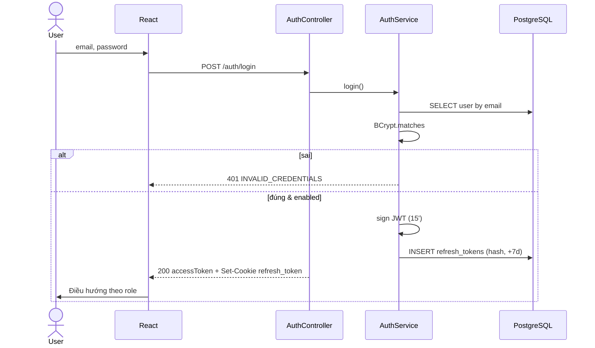

# [FD-AUTH-02] Đăng nhập (Log In)

## 0. Thông tin tài liệu

| Mục | Nội dung |
|---|---|
| Mã chức năng | FD-AUTH-02 |
| Tên | Đăng nhập (Log In) |
| Module | AUTH |
| Version | v0.1 |
| Trạng thái | Draft |
| Người viết | A |
| Người duyệt | A (kỹ thuật) · PO (nghiệp vụ) |
| Owner | BE: A · FE: C |
| Task | KTV-07, KTV-10 |

| Version | Ngày | Người | Nội dung |
|---|---|---|---|
| v0.1 | 2026-10-21 | A | Tạo mới |

## 1. Tổng quan

- **Mục đích:** Xác thực người dùng (Customer, Staff, Admin) và cấp phiên làm việc.
- **Phạm vi:** đăng nhập email + mật khẩu, cấp JWT access + refresh token, điều hướng theo role.
- **Actor:** Guest (trở thành Customer / Staff / Admin).
- **Ưu tiên:** Must.
- **Tham chiếu:** C01 · NFR-01, NFR-02 · SCR-C02 · FD-AUTH-01, FD-AUTH-03.

## 2. Mô tả nghiệp vụ

### 2.1 Tiền điều kiện
- Có tài khoản, `enabled = true`.

### 2.2 Hậu điều kiện
- **Thành công:** FE giữ access token (bộ nhớ), refresh token ở cookie httpOnly; 1 bản ghi `refresh_tokens` mới.
- **Thất bại:** không cấp token.

### 2.3 Luồng chính
1. Người dùng nhập email, mật khẩu trên SCR-C02.
2. Hệ thống tìm user theo email (lowercase), so khớp BCrypt.
3. Kiểm tra `enabled`.
4. Sinh **access token** JWT (HS256, 15 phút, claims: `sub=userId`, `role`, `branchId`).
5. Sinh **refresh token** ngẫu nhiên (32 byte, base64url), lưu **hash SHA-256** vào `refresh_tokens` (hạn 7 ngày), trả qua cookie `refresh_token` (`HttpOnly; Secure; SameSite=None; Path=/api/v1/auth`).
6. FE điều hướng: `redirect` param nếu có; nếu không → Customer: `/`, Staff: `/staff`, Admin: `/admin`.

### 2.4 Luồng thay thế / ngoại lệ

| Mã | Tại bước | Điều kiện | Xử lý |
|---|---|---|---|
| E1 | 2 | Sai email hoặc mật khẩu | 401 `INVALID_CREDENTIALS` – **cùng một thông báo** cho cả 2 trường hợp |
| E2 | 3 | Tài khoản bị khóa | 403 `ACCOUNT_DISABLED` |

### 2.5 Sequence diagram
Xem 4.3.

## 3. Giao diện

- **Màn hình:** SCR-C02 – **Wireframe: TODO**

### 3.1 Danh sách item

| No | Item | Loại | Bắt buộc | Validate |
|---|---|---|---|---|
| 1 | Email | Input | ✓ | Định dạng email |
| 2 | Mật khẩu | Password | ✓ | ≥ 1 ký tự |
| 3 | Link "Quên mật khẩu?" | Link | – | → SCR-C03 |
| 4 | Nút "Đăng nhập" | Button | – | Loading khi gửi |
| 5 | Link "Đăng ký" | Link | – | → SCR-C01 |

### 3.3 Thông báo

| Mã | Điều kiện | Nội dung |
|---|---|---|
| MSG-AUTH-03 | E1 | "Email hoặc mật khẩu không đúng" |
| MSG-AUTH-04 | E2 | "Tài khoản đã bị khóa. Vui lòng liên hệ quản trị viên." |

## 4. Thiết kế xử lý

### 4.1 API

| Mục | Giá trị |
|---|---|
| Endpoint | `POST /api/v1/auth/login` |
| Quyền | Public |

**Request** `{ "email": "a@example.com", "password": "secret123" }`

**Response 200** (+ header `Set-Cookie: refresh_token=...`)
```json
{ "success": true, "data": {
  "accessToken": "eyJ...", "expiresIn": 900,
  "user": { "id": 7, "fullName": "Nguyễn Văn A", "email": "a@example.com", "role": "CUSTOMER", "branchId": null } } }
```

### 4.3 Sequence diagram



### 4.4 Dữ liệu tác động

| Bảng | C | R | U | D |
|---|---|---|---|---|
| users | | ✓ | | |
| refresh_tokens | ✓ | | | |

## 5. Bảo mật & phân quyền
- Access token chỉ giữ trong bộ nhớ (Zustand), **không** lưu `localStorage`.
- `JWT_SECRET` ≥ 256 bit, từ biến môi trường.
- CORS `allowCredentials=true`, origin = `FRONTEND_URL`.

## 6. Yêu cầu phi chức năng
- NFR-01, NFR-02. Thời gian phản hồi < 500ms (BCrypt cost 10 ≈ 80ms).

## 7. Tiêu chí nghiệm thu

| Mã | Given | When | Then |
|---|---|---|---|
| AC-AUTH-02-01 | Customer hợp lệ | Đăng nhập | 200, có cookie, về trang chủ |
| AC-AUTH-02-02 | Staff | Đăng nhập | Về `/staff`, token có `branchId` |
| AC-AUTH-02-03 | – | Sai mật khẩu / email không tồn tại | Cùng 401 + cùng thông báo |
| AC-AUTH-02-04 | User bị khóa | Đăng nhập đúng mật khẩu | 403 |
| AC-AUTH-02-05 | Đang ở bước hold (BKG-01 A1) | Đăng nhập | Quay lại SCR-C07 và tự giữ chỗ |

## 8. Vấn đề mở / Giả định

| # | Nội dung | Loại | Người xử lý | Trạng thái |
|---|---|---|---|---|
| 1 | Khóa tạm sau N lần sai – ngoài phạm vi | Giả định | A | Open |
| 2 | Cookie cross-site (Vercel ↔ Render) cần HTTPS cả 2 phía; local dùng proxy Vite để cùng origin | Rủi ro | A, D | Open |
| 3 | Mã lỗi mới `INVALID_CREDENTIALS` (401), `ACCOUNT_DISABLED` (403) | Bổ sung | A | Đã thêm |

## 9. Phê duyệt

| Vai trò | Người | Ngày | Kết quả |
|---|---|---|---|
| Tech Lead | A | | |
| PO / Trưởng nhóm | | | |
