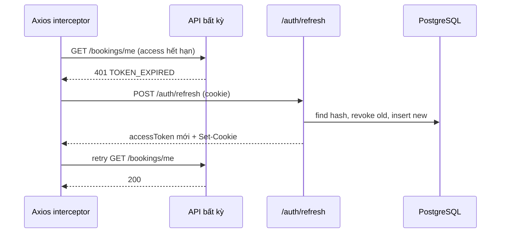

# [FD-AUTH-03] Duy trì và kết thúc phiên đăng nhập (Manage Session)

## 0. Thông tin tài liệu

| Mục | Nội dung |
|---|---|
| Mã chức năng | FD-AUTH-03 |
| Tên | Duy trì và kết thúc phiên đăng nhập (Manage Session) |
| Module | AUTH |
| Version | v0.1 |
| Trạng thái | Draft |
| Người viết | A |
| Người duyệt | A (kỹ thuật) · PO (nghiệp vụ) |
| Owner | BE: A · FE: C |
| Task | KTV-07, KTV-09 |

| Version | Ngày | Người | Nội dung |
|---|---|---|---|
| v0.1 | 2026-10-21 | A | Tạo mới |

## 1. Tổng quan

- **Mục đích:** Giữ người dùng đăng nhập liên tục (tối đa 7 ngày) mà không phải nhập lại mật khẩu, đồng thời cho phép đăng xuất an toàn.
- **Phạm vi:** làm mới access token (refresh + rotation), khôi phục phiên khi tải lại trang, đăng xuất.
- **Actor:** Customer, Staff, Admin.
- **Ưu tiên:** Must.
- **Tham chiếu:** C01 · NFR-01 · FD-AUTH-02, FD-USR-01, FD-USR-02, FD-AUTH-04.

## 2. Mô tả nghiệp vụ

### 2.1 Tiền điều kiện
- Đã đăng nhập (có cookie refresh token).

### 2.2 Hậu điều kiện
- **Refresh:** refresh token cũ bị thu hồi, cấp cặp token mới.
- **Logout:** refresh token hiện tại bị thu hồi, cookie bị xóa.

### 2.3 Luồng chính

**A. Làm mới token**
1. API trả 401 `TOKEN_EXPIRED` → axios interceptor gọi `POST /auth/refresh` (cookie tự gửi kèm).
2. Hệ thống tìm token theo hash; kiểm tra chưa thu hồi, chưa hết hạn, user còn `enabled`.
3. Thu hồi token cũ, cấp access token mới + refresh token mới (**rotation**).
4. Interceptor gửi lại request ban đầu. Các request 401 đồng thời **xếp hàng chờ** một lần refresh duy nhất.

**B. Khôi phục phiên khi tải lại trang**
1. App khởi động → gọi `POST /auth/refresh`; thành công → có access token + `user`; thất bại → trạng thái khách.

**C. Đăng xuất**
1. Người dùng bấm "Đăng xuất" → `POST /auth/logout`.
2. Hệ thống thu hồi refresh token hiện tại, trả cookie hết hạn.
3. FE xóa state, về trang chủ.

### 2.4 Luồng thay thế / ngoại lệ

| Mã | Tại bước | Điều kiện | Xử lý |
|---|---|---|---|
| E1 | A2 | Token không tồn tại / hết hạn | 401 `INVALID_TOKEN` → FE về SCR-C02 với `redirect` |
| E2 | A2 | **Token đã bị thu hồi được dùng lại** (nghi bị đánh cắp) | Thu hồi **tất cả** refresh token của user, 401 `INVALID_TOKEN` |
| E3 | A2 | User bị khóa | 403 `ACCOUNT_DISABLED` |

## 3. Giao diện
- Không có màn hình riêng; nút "Đăng xuất" trong menu tài khoản (mọi layout).

## 4. Thiết kế xử lý

### 4.1 API

| Method | Endpoint | Quyền | Response |
|---|---|---|---|
| POST | `/api/v1/auth/refresh` | Cookie | `{ accessToken, expiresIn, user }` + `Set-Cookie` mới |
| POST | `/api/v1/auth/logout` | Cookie | 204 + cookie `Max-Age=0` |

### 4.2 Các bước xử lý
```
refresh(rawToken):
  rt = repo.findByHash(sha256(rawToken)) ?: INVALID_TOKEN
  if rt.revoked: repo.revokeAllByUser(rt.userId); throw INVALID_TOKEN
  if rt.expiresAt < now: INVALID_TOKEN
  if !user.enabled: ACCOUNT_DISABLED
  rt.revoked = true; issue new pair
```
- Job dọn `refresh_tokens` hết hạn mỗi ngày (tùy chọn).

### 4.3 Sequence diagram



### 4.4 Dữ liệu tác động

| Bảng | C | R | U | D |
|---|---|---|---|---|
| refresh_tokens | ✓ | ✓ | ✓ | (job) |
| users | | ✓ | | |

## 5. Bảo mật & phân quyền
- Chỉ lưu **hash** refresh token. Cột `refresh_tokens.token` đổi tên thành `token_hash`.
- Đổi mật khẩu (USR-01), đặt lại mật khẩu (AUTH-04), khóa tài khoản (USR-02) → thu hồi toàn bộ refresh token.

## 6. Yêu cầu phi chức năng
- Người dùng không thấy gián đoạn khi access token hết hạn.

## 7. Tiêu chí nghiệm thu

| Mã | Given | When | Then |
|---|---|---|---|
| AC-AUTH-03-01 | Access hết hạn, refresh còn hạn | Gọi API | Tự refresh, request thành công |
| AC-AUTH-03-02 | 3 request cùng 401 | – | Chỉ 1 lần gọi `/auth/refresh` |
| AC-AUTH-03-03 | Refresh token R1 đã rotate thành R2 | Dùng lại R1 | 401; R2 cũng bị thu hồi |
| AC-AUTH-03-04 | Đã đăng nhập | Tải lại trang | Vẫn đăng nhập |
| AC-AUTH-03-05 | – | Đăng xuất rồi dùng lại cookie cũ | 401 |

## 8. Vấn đề mở / Giả định

| # | Nội dung | Loại | Người xử lý | Trạng thái |
|---|---|---|---|---|
| 1 | Đổi `refresh_tokens.token` → `token_hash` trong 02-architecture | Bổ sung | A | Đã cập nhật |
| 2 | Mã lỗi mới `INVALID_TOKEN` (401) | Bổ sung | A | Đã thêm |

## 9. Phê duyệt

| Vai trò | Người | Ngày | Kết quả |
|---|---|---|---|
| Tech Lead | A | | |
| PO / Trưởng nhóm | | | |
