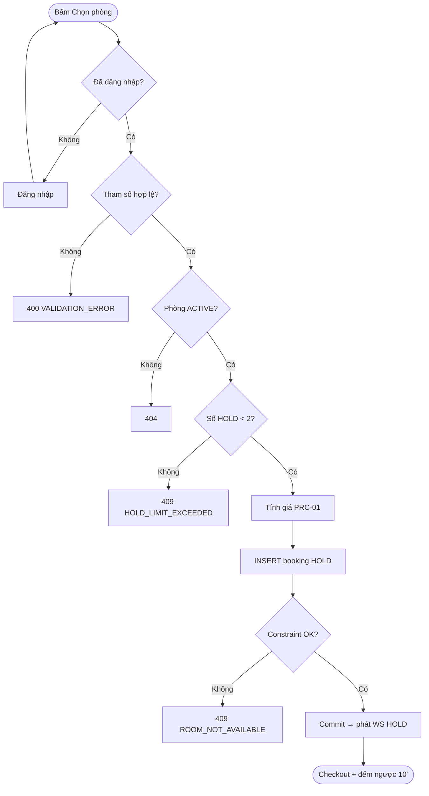
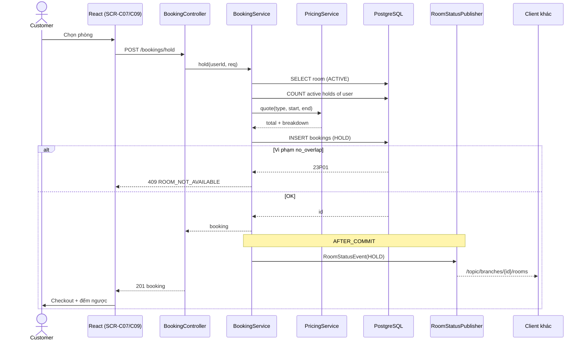

# [FD-BKG-01] Giữ chỗ phòng (Hold Room) ⭐

## 0. Thông tin tài liệu

| Mục | Nội dung |
|---|---|
| Mã chức năng | FD-BKG-01 |
| Tên | Giữ chỗ phòng (Hold Room) |
| Module | BKG |
| Version | v0.1 |
| Trạng thái | Draft |
| Người viết | A |
| Người duyệt | A (kỹ thuật) · PO (nghiệp vụ) |
| Owner | BE: A · FE: C |
| Task | KTV-24, KTV-25, KTV-41, KTV-48 |

| Version | Ngày | Người | Nội dung |
|---|---|---|---|
| v0.1 | 2026-10-21 | A | Tạo mới |

## 1. Tổng quan

- **Mục đích:** Khi khách chọn một phòng, hệ thống tạm khóa phòng đó trong **10 phút** để khách hoàn tất đặt phòng mà không bị người khác "giành" mất. Đây là cơ chế chống đặt trùng và là phần lõi của tính năng nổi bật.
- **Phạm vi:** tạo booking `HOLD`, chốt giá tạm tính, phát sự kiện real-time. **Ngoài phạm vi:** đặt món (BKG-04), thanh toán (BKG-05, PAY-01).
- **Actor:** Customer (chính) · Hệ thống WebSocket (phụ).
- **Ưu tiên:** Must.
- **Tham chiếu:** C06 · BR-01→BR-08, BR-10, BR-11, BR-24 · NFR-03, NFR-05 · SCR-C07, SCR-C09 · FD-ROM-02, FD-ROM-03, FD-PRC-01, FD-BKG-02, FD-BKG-03, FD-BKG-05.

## 2. Mô tả nghiệp vụ

### 2.1 Tiền điều kiện
- Khách đã đăng nhập với role `CUSTOMER`.
- Khách đã chọn chi nhánh, ngày, giờ bắt đầu, số giờ, số người (từ ROM-02 hoặc ROM-03).
- Phòng ở trạng thái `ACTIVE`.

### 2.2 Hậu điều kiện
- **Thành công:** có 1 bản ghi `bookings` trạng thái `HOLD`, `hold_expires_at = now + 10'`; mọi client đang xem sơ đồ chi nhánh thấy phòng chuyển 🟡; khách được chuyển tới trang checkout có đồng hồ đếm ngược.
- **Thất bại:** không có bản ghi nào được tạo; khách nhận thông báo lỗi và quay về kết quả tìm kiếm.

### 2.3 Luồng chính
1. Khách bấm **"Chọn phòng"** trên một phòng 🟢 ở SCR-C07.
2. FE kiểm tra đã đăng nhập; gửi yêu cầu giữ chỗ.
3. Hệ thống validate tham số (BR-01→BR-04).
4. Hệ thống kiểm tra phòng `ACTIVE` (BR-08).
5. Hệ thống đếm số `HOLD` còn hiệu lực của khách; nếu < 2 thì tiếp tục (BR-07).
6. Hệ thống tính giá phòng qua FD-PRC-01 và chốt vào `room_amount` (BR-24).
7. Hệ thống tạo booking `HOLD`, sinh mã `KTV-YYYYMMDD-NNNN`.
8. Database kiểm tra exclusion constraint (BR-05, BR-06) → hợp lệ.
9. Sau commit, hệ thống phát sự kiện `HOLD` lên topic của chi nhánh (BR-11).
10. Hệ thống trả về booking; FE điều hướng sang SCR-C09 và bắt đầu đếm ngược theo `holdExpiresAt`.

### 2.4 Luồng thay thế / ngoại lệ

| Mã | Tại bước | Điều kiện | Xử lý |
|---|---|---|---|
| A1 | 2 | Chưa đăng nhập | Lưu tham số tìm kiếm + `roomId` vào `sessionStorage`, chuyển tới SCR-C02; đăng nhập xong quay lại và tự gửi lại yêu cầu |
| E1 | 3 | Tham số sai BR-01→BR-04 | 400 `VALIDATION_ERROR`, hiển thị lỗi theo field |
| E2 | 4 | Phòng không tồn tại / `MAINTENANCE` | 404 `NOT_FOUND` – "Phòng hiện không phục vụ" |
| E3 | 5 | Khách đã có 2 `HOLD` | 409 `HOLD_LIMIT_EXCEEDED` – gợi ý link tới các đơn đang giữ |
| E4 | 8 | Vi phạm exclusion constraint (người khác vừa giữ / đặt) | 409 `ROOM_NOT_AVAILABLE`; FE refetch sơ đồ, phòng chuyển 🟡/🔴 |
| E5 | 6 | Không tìm thấy price rule phủ khoảng giờ | 422 `PRICE_NOT_CONFIGURED` – log WARN cho admin |

### 2.5 Activity diagram



### 2.6 Quy tắc nghiệp vụ áp dụng
| BR | Nội dung tóm tắt |
|---|---|
| BR-01 | 1–6 giờ, bước 30 phút |
| BR-02 | Bắt đầu ≥ now + 30', trong giờ mở cửa |
| BR-03 | Đặt trước tối đa 14 ngày |
| BR-04 | Số người ≤ sức chứa loại phòng |
| BR-05/06 | Không chồng giờ, buffer 15 phút |
| BR-07 | Tối đa 2 `HOLD` / khách |
| BR-10 | `HOLD` sống 10 phút |
| BR-24 | Chốt giá tại thời điểm tạo |

## 3. Giao diện

- **Màn hình:** SCR-C07 (nút chọn phòng), SCR-C09 (checkout) – **Wireframe: TODO**
- **Điều hướng:** SCR-C07 → SCR-C09 · lỗi E3/E4 ở lại SCR-C07.

### 3.1 Danh sách item (SCR-C09 – phần giữ chỗ)

| No | Item | Loại | Ghi chú |
|---|---|---|---|
| 1 | Mã đơn | Text | `code` |
| 2 | Thông tin phòng | Card | Chi nhánh, mã phòng, loại, sức chứa |
| 3 | Thời gian | Text | `DD/MM/YYYY HH:mm – HH:mm` (Asia/Ho_Chi_Minh) |
| 4 | Đồng hồ đếm ngược | Countdown | Tính từ `holdExpiresAt` – giờ server (dùng `serverTime` trả về để bù lệch) |
| 5 | Tiền phòng tạm tính | Number | Format `480.000đ`, hiển thị breakdown theo khung giờ |
| 6 | Nút "Bỏ giữ chỗ" | Button | → FD-BKG-02 |

### 3.2 Sự kiện

| No | Item | Sự kiện | Xử lý |
|---|---|---|---|
| 1 | Nút "Chọn phòng" (SCR-C07) | Click | Disable nút, gọi API; xong thì điều hướng |
| 2 | Đồng hồ | Còn 2 phút | Đổi màu cam + toast "Còn 2 phút để hoàn tất" |
| 3 | Đồng hồ | Về 0 | Khóa form, modal "Giữ chỗ đã hết hạn" → nút "Tìm lại" về SCR-C07 |

### 3.3 Thông báo

| Mã | Điều kiện | Nội dung |
|---|---|---|
| MSG-BKG-01 | E3 | "Bạn đang giữ tối đa 2 phòng. Hoàn tất hoặc bỏ giữ chỗ trước khi chọn phòng khác." |
| MSG-BKG-02 | E4 | "Rất tiếc, phòng vừa có người chọn. Vui lòng chọn phòng khác." |
| MSG-BKG-03 | Hết giờ | "Thời gian giữ chỗ đã hết. Phòng đã được mở lại." |

## 4. Thiết kế xử lý

### 4.1 API

| Mục | Giá trị |
|---|---|
| Endpoint | `POST /api/v1/bookings/hold` |
| Quyền | `CUSTOMER` |
| Transaction | Có (`READ_COMMITTED`) |

**Request**
```json
{ "roomId": 12, "startTime": "2026-10-28T19:00:00+07:00", "hours": 2.5, "people": 6 }
```

**Response 201**
```json
{
  "success": true,
  "data": {
    "id": 1024, "code": "KTV-20261028-0007", "status": "HOLD",
    "room": { "id": 12, "code": "V02", "type": "VIP", "branchId": 1 },
    "startTime": "2026-10-28T19:00:00+07:00", "endTime": "2026-10-28T21:30:00+07:00",
    "people": 6, "roomAmount": 675000,
    "priceBreakdown": [ { "from": "19:00", "to": "21:30", "hours": 2.5, "unitPrice": 270000, "amount": 675000 } ],
    "holdExpiresAt": "2026-10-21T15:10:00+07:00", "serverTime": "2026-10-21T15:00:00+07:00"
  }
}
```

**Lỗi**

| HTTP | Code | Khi nào |
|---|---|---|
| 400 | `VALIDATION_ERROR` | E1 |
| 401 | `UNAUTHORIZED` | Chưa đăng nhập |
| 404 | `NOT_FOUND` | E2 |
| 409 | `HOLD_LIMIT_EXCEEDED` | E3 |
| 409 | `ROOM_NOT_AVAILABLE` | E4 |
| 422 | `PRICE_NOT_CONFIGURED` | E5 |

### 4.2 Các bước xử lý (`BookingService.hold`)
```
1. validate(req) theo BR-01..04 (Bean Validation + BookingRuleValidator)
2. room = roomRepo.findActiveById(roomId) ?: throw NOT_FOUND
3. if bookingRepo.countActiveHolds(userId, now) >= 2 → throw HOLD_LIMIT_EXCEEDED
4. quote = pricingService.quote(room.type, start, end)        // FD-PRC-01
5. booking = new Booking(status=HOLD, holdExpiresAt=now+10m, roomAmount=quote.total,
                         total=quote.total, code=codeGenerator.next(date))
6. try bookingRepo.saveAndFlush(booking)
   catch DataIntegrityViolation (SQLState 23P01) → throw ROOM_NOT_AVAILABLE
7. publisher.publish(RoomStatusEvent(HOLD, ...))                // AFTER_COMMIT
8. return BookingHoldResponse
```
- `countActiveHolds`: `status IN ('HOLD','PENDING_PAYMENT') AND hold_expires_at > now()`.
- Mã đơn: sequence theo ngày (`booking_code_seq` reset theo ngày hoặc `COUNT+1` trong cùng transaction với unique constraint + retry 1 lần).

### 4.3 Sequence diagram



### 4.4 Dữ liệu tác động

| Bảng | C | R | U | D | Ghi chú |
|---|---|---|---|---|---|
| rooms | | ✓ | | | Kiểm tra `ACTIVE` |
| room_types | | ✓ | | | Sức chứa |
| price_rules, holidays | | ✓ | | | Qua PRC-01 |
| bookings | ✓ | ✓ | | | Đếm HOLD, insert |

### 4.5 Tích hợp / sự kiện
- WebSocket `/topic/branches/{branchId}/rooms` payload `{ roomId, status: "HOLD", from, to, holdExpiresAt }`.

## 5. Bảo mật & phân quyền
- `@PreAuthorize("hasRole('CUSTOMER')")`; `userId` lấy từ JWT, **không** nhận từ request.
- Payload WebSocket **không** chứa thông tin khách (tên, SĐT, userId).

## 6. Yêu cầu phi chức năng
- Phản hồi < 500ms (NFR-03).
- **Đồng thời:** 10 request cùng phòng cùng giờ → đúng 1 thành công, 9 nhận 409 (test KTV-25).
- Thời gian lưu `timestamptz`, FE gửi ISO-8601 có offset (NFR-05).

## 7. Tiêu chí nghiệm thu

| Mã | Given | When | Then |
|---|---|---|---|
| AC-BKG-01-01 | Phòng trống, khách đã đăng nhập | Gửi hold hợp lệ | 201, `status=HOLD`, `holdExpiresAt = now+10'` |
| AC-BKG-01-02 | Khách B đang xem sơ đồ cùng chi nhánh | Khách A hold thành công | Màn hình B đổi phòng sang 🟡 trong ≤ 2 giây |
| AC-BKG-01-03 | Khách A đã hold phòng 19:00–21:00 | Khách B hold cùng phòng 20:00–22:00 | 409 `ROOM_NOT_AVAILABLE` |
| AC-BKG-01-04 | Đơn trước kết thúc 21:00 | Hold từ 21:00 | 409 (vướng buffer 15') ; hold từ 21:15 → 201 |
| AC-BKG-01-05 | Khách đang có 2 HOLD | Hold phòng thứ 3 | 409 `HOLD_LIMIT_EXCEEDED` |
| AC-BKG-01-06 | – | `hours = 0.75` hoặc `7` | 400 `VALIDATION_ERROR` |
| AC-BKG-01-07 | – | `startTime` < now + 30' hoặc > 14 ngày | 400 |
| AC-BKG-01-08 | 10 request đồng thời cùng slot | Gửi song song | Đúng 1 bản ghi HOLD được tạo |
| AC-BKG-01-09 | Admin đổi giá sau khi hold | Xem lại đơn | `roomAmount` giữ nguyên |

## 8. Vấn đề mở / Giả định

| # | Nội dung | Loại | Người xử lý | Trạng thái |
|---|---|---|---|---|
| 1 | Mã lỗi `PRICE_NOT_CONFIGURED` chưa có trong 02-architecture §3.4 | Bổ sung | A | Đã thêm |
| 2 | Giữ chỗ khi chưa đăng nhập (guest hold)? Giả định: **không**, bắt buộc đăng nhập | Giả định | PO | Open |

## 9. Phê duyệt

| Vai trò | Người | Ngày | Kết quả |
|---|---|---|---|
| Tech Lead | A | | |
| PO / Trưởng nhóm | | | |
