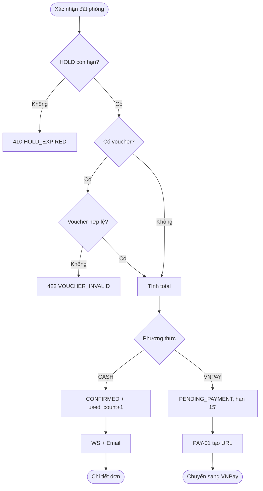

# [FD-BKG-05] Xác nhận đặt phòng (Confirm Booking)

## 0. Thông tin tài liệu

| Mục | Nội dung |
|---|---|
| Mã chức năng | FD-BKG-05 |
| Tên | Xác nhận đặt phòng (Confirm Booking) |
| Module | BKG |
| Version | v0.1 |
| Trạng thái | Draft |
| Người viết | A |
| Người duyệt | A (kỹ thuật) · PO (nghiệp vụ) |
| Owner | BE: A · FE: C |
| Task | KTV-27, KTV-32, KTV-49 |

| Version | Ngày | Người | Nội dung |
|---|---|---|---|
| v0.1 | 2026-10-21 | A | Tạo mới |

## 1. Tổng quan

- **Mục đích:** Chuyển một lượt giữ chỗ thành đơn đặt phòng chính thức theo phương thức thanh toán khách chọn.
- **Phạm vi:** chốt voucher, tính tổng tiền cuối, chọn `CASH` (xác nhận ngay) hoặc `VNPAY` (chuyển sang cổng thanh toán). **Ngoài phạm vi:** chi tiết tích hợp VNPay (PAY-01, PAY-02).
- **Actor:** Customer.
- **Ưu tiên:** Must (`CASH`) / Should (`VNPAY`).
- **Tham chiếu:** C07, C09 · BR-23, BR-30→BR-32, BR-40, BR-41, BR-44 · SCR-C09 · FD-BKG-01, FD-BKG-04, FD-VCH-01, FD-PAY-01, FD-NTF-01, FD-BKG-08.

## 2. Mô tả nghiệp vụ

### 2.1 Tiền điều kiện
- Khách là chủ booking `HOLD` còn hạn.

### 2.2 Hậu điều kiện
- **CASH:** booking `CONFIRMED`, `payment_method = CASH`, voucher `used_count + 1`, email xác nhận được gửi, phòng 🔴 trên sơ đồ.
- **VNPAY:** booking `PENDING_PAYMENT`, `hold_expires_at = now + 15'` (BR-44), 1 payment `PENDING`, khách được chuyển sang cổng VNPay.
- **Thất bại:** booking giữ nguyên `HOLD`.

### 2.3 Luồng chính
1. Khách xem tóm tắt đơn trên SCR-C09 (phòng, thời gian, món, tiền).
2. (Tùy chọn) Khách nhập voucher – FE gọi VCH-01 để xem trước giảm giá.
3. Khách chọn phương thức: **Trả tại quầy** hoặc **VNPay**, tích ô đồng ý chính sách hủy, bấm **"Xác nhận đặt phòng"**.
4. Hệ thống khóa booking, kiểm tra `HOLD` còn hạn.
5. Nếu có voucher → kiểm tra lại điều kiện (BR-31) và tính `discount`.
6. Hệ thống tính `total = round1000(room_amount + fnb_amount − discount)` (BR-23).
7. **Nhánh CASH:** chuyển `CONFIRMED`, tăng `used_count` voucher, xóa `hold_expires_at`; sau commit phát WS `CONFIRMED` và gửi email (NTF-01). FE chuyển SCR-C12.
8. **Nhánh VNPAY:** chuyển `PENDING_PAYMENT`, `hold_expires_at = now + 15'`; gọi PAY-01 tạo payment `PENDING` + URL; trả `paymentUrl`; FE `window.location` sang VNPay.

### 2.4 Luồng thay thế / ngoại lệ

| Mã | Tại bước | Điều kiện | Xử lý |
|---|---|---|---|
| A1 | 2 | Không nhập voucher | `discount = 0` |
| E1 | 4 | HOLD hết hạn / không còn `HOLD` | 410 `HOLD_EXPIRED` → FE modal hết hạn |
| E2 | 5 | Voucher không hợp lệ | 422 `VOUCHER_INVALID` (`details.reason`), booking vẫn `HOLD` |
| E3 | 3 | Chưa tích đồng ý chính sách | FE chặn, không gọi API |
| E4 | 8 | Lỗi tạo URL VNPay | Rollback về `HOLD`, 502 `PAYMENT_GATEWAY_ERROR` |

### 2.5 Activity diagram



### 2.6 Quy tắc nghiệp vụ áp dụng
- **BR-23** công thức tổng tiền · **BR-31/32** voucher · **BR-40** VNPay trả trước 100% · **BR-41** CASH tự hủy nếu no-show · **BR-44** PENDING_PAYMENT 15'.

## 3. Giao diện

- **Màn hình:** SCR-C09 – khu vực "Thanh toán" – **Wireframe: TODO**
- **Điều hướng:** CASH → SCR-C12 · VNPAY → cổng VNPay → SCR-C10.

### 3.1 Danh sách item

| No | Item | Loại | Bắt buộc | Mặc định | Validate / Ghi chú |
|---|---|---|---|---|---|
| 1 | Tóm tắt tiền | Table | – | – | Tiền phòng, đồ ăn uống, giảm giá, **tổng** |
| 2 | Mã voucher | Input + nút "Áp dụng" | ✗ | – | ≤ 30 ký tự, tự upper-case |
| 3 | Phương thức thanh toán | Radio | ✓ | VNPay | `VNPAY` / `CASH` |
| 4 | Ghi chú chính sách | Text | – | – | Chính sách hủy (01-business §4.6) + "Trả tại quầy: tự hủy nếu đến muộn quá 15 phút" |
| 5 | Đồng ý chính sách | Checkbox | ✓ | false | |
| 6 | Nút "Xác nhận đặt phòng" | Button | – | – | Disable khi (5) chưa tích hoặc đang gửi |

### 3.3 Thông báo

| Mã | Điều kiện | Nội dung |
|---|---|---|
| MSG-BKG-07 | CASH thành công | "Đặt phòng thành công! Mã đơn {code}. Vui lòng đến đúng giờ." |
| MSG-BKG-08 | E4 | "Không kết nối được cổng thanh toán. Vui lòng thử lại hoặc chọn trả tại quầy." |

## 4. Thiết kế xử lý

### 4.1 API

| Mục | Giá trị |
|---|---|
| Endpoint | `POST /api/v1/bookings/{id}/confirm` |
| Quyền | `CUSTOMER` (chủ booking) |
| Transaction | Có |

**Request**
```json
{ "paymentMethod": "VNPAY", "voucherCode": "KTV10" }
```

**Response 200 – CASH**
```json
{ "success": true, "data": { "id": 1024, "code": "KTV-20261028-0007", "status": "CONFIRMED",
  "roomAmount": 675000, "fnbAmount": 345000, "discount": 102000, "total": 918000 } }
```

**Response 200 – VNPAY**
```json
{ "success": true, "data": { "id": 1024, "status": "PENDING_PAYMENT", "total": 918000,
  "paymentUrl": "https://sandbox.vnpayment.vn/paymentv2/vpcpay.html?...",
  "paymentExpiresAt": "2026-10-21T15:20:00+07:00" } }
```

**Lỗi**

| HTTP | Code | Khi nào |
|---|---|---|
| 400 | `VALIDATION_ERROR` | `paymentMethod` sai |
| 403 | `FORBIDDEN` | Không phải chủ |
| 410 | `HOLD_EXPIRED` | E1 |
| 422 | `VOUCHER_INVALID` | E2 |
| 502 | `PAYMENT_GATEWAY_ERROR` | E4 |

### 4.2 Các bước xử lý
```
1. booking = findByIdForUpdate(id); check owner
2. if status != HOLD || holdExpiresAt <= now → HOLD_EXPIRED
3. discount = voucherCode ? voucherService.calculate(code, room+fnb) : 0     // FD-VCH-01
4. booking.discount, booking.voucherId, booking.total = round1000(room + fnb − discount)
5. switch method:
   CASH  → status=CONFIRMED, holdExpiresAt=null, voucherService.markUsed(voucherId)
           events: RoomStatusEvent(CONFIRMED), BookingConfirmedEvent (→ email)
   VNPAY → status=PENDING_PAYMENT, holdExpiresAt=now+15m
           paymentUrl = vnPayService.createPayment(booking, clientIp)         // FD-PAY-01
6. return response
```
- Voucher với VNPAY: chỉ **giữ** `voucher_id` + `discount`; `used_count` tăng ở PAY-02 khi IPN thành công (BR-32).

### 4.3 Sequence diagram

```mermaid
sequenceDiagram
  actor U as Customer
  participant FE as React (SCR-C09)
  participant BS as BookingService
  participant VS as VoucherService
  participant VP as VnPayService
  participant DB as PostgreSQL
  participant EV as Events (WS, Email)

  U->>FE: Xác nhận (method, voucher)
  FE->>BS: POST /bookings/{id}/confirm
  BS->>DB: SELECT ... FOR UPDATE
  opt có voucher
    BS->>VS: calculate(code, subtotal)
    VS-->>BS: discount
  end
  alt CASH
    BS->>DB: UPDATE status=CONFIRMED; vouchers.used_count+1
    BS-->>FE: 200 CONFIRMED
    Note over BS,EV: AFTER_COMMIT
    BS->>EV: RoomStatus(CONFIRMED), BookingConfirmed → email
  else VNPAY
    BS->>DB: UPDATE status=PENDING_PAYMENT, hold_expires_at=+15'
    BS->>VP: createPayment(booking)
    VP->>DB: INSERT payments (PENDING, txn_ref)
    VP-->>BS: paymentUrl
    BS-->>FE: 200 paymentUrl
    FE->>U: Redirect VNPay
  end
```

### 4.4 Dữ liệu tác động

| Bảng | C | R | U | D | Ghi chú |
|---|---|---|---|---|---|
| bookings | | ✓ | ✓ | | status, discount, voucher_id, total, payment_method, hold_expires_at |
| vouchers | | ✓ | ✓ | | `used_count` (chỉ CASH) |
| payments | ✓ | | | | Chỉ VNPAY (qua PAY-01) |

### 4.5 Tích hợp / sự kiện
- WS: `CONFIRMED` (CASH) hoặc `PENDING_PAYMENT` (VNPAY, màu 🟡 giữ nguyên).
- Email xác nhận: NTF-01 (CASH ngay; VNPAY sau IPN).

## 5. Bảo mật & phân quyền
- Chỉ chủ booking; tổng tiền **luôn tính lại ở server**.

## 6. Yêu cầu phi chức năng
- Phản hồi < 500ms (không tính gửi email – chạy `@Async`).

## 7. Tiêu chí nghiệm thu

| Mã | Given | When | Then |
|---|---|---|---|
| AC-BKG-05-01 | HOLD còn hạn | Confirm CASH | `CONFIRMED`, email gửi, sơ đồ 🔴 |
| AC-BKG-05-02 | HOLD còn hạn | Confirm VNPAY | `PENDING_PAYMENT`, có `paymentUrl`, payment `PENDING` |
| AC-BKG-05-03 | Phòng 675k + món 345k, voucher 10% max 200k | Confirm | `discount=102000`, `total=918000` |
| AC-BKG-05-04 | Voucher hết lượt | Confirm | 422, booking vẫn `HOLD` |
| AC-BKG-05-05 | HOLD hết hạn | Confirm | 410 |
| AC-BKG-05-06 | Voucher còn 1 lượt, CASH | Confirm | `used_count` = `usage_limit` |

## 8. Vấn đề mở / Giả định

| # | Nội dung | Loại | Người xử lý | Trạng thái |
|---|---|---|---|---|
| 1 | Voucher với VNPAY: lượt cuối có thể bị 2 khách cùng giữ; khi IPN đến mà hết lượt → **vẫn chấp nhận** (đã thu tiền) | Giả định | PO | Open |
| 2 | Mã lỗi mới `PAYMENT_GATEWAY_ERROR` (502) | Bổ sung | A | Đã thêm |

## 9. Phê duyệt

| Vai trò | Người | Ngày | Kết quả |
|---|---|---|---|
| Tech Lead | A | | |
| PO / Trưởng nhóm | | | |
