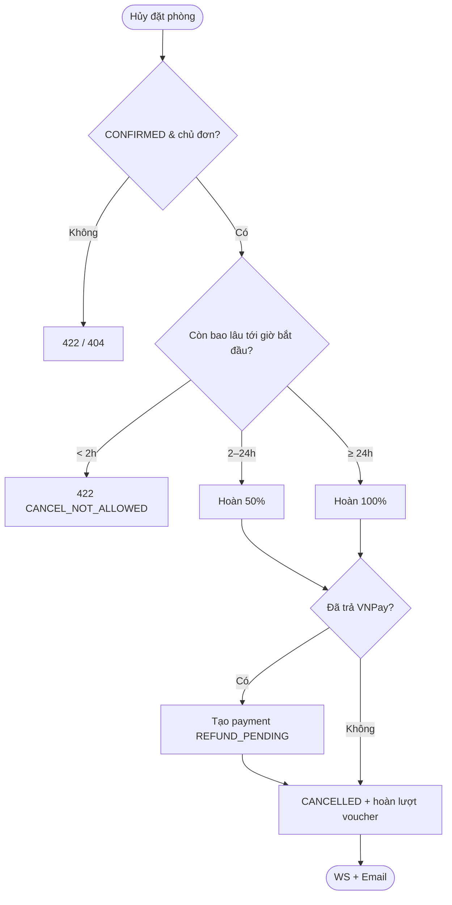

# [FD-BKG-07] Hủy đặt phòng (Cancel Booking)

## 0. Thông tin tài liệu

| Mục | Nội dung |
|---|---|
| Mã chức năng | FD-BKG-07 |
| Tên | Hủy đặt phòng (Cancel Booking) |
| Module | BKG |
| Version | v0.1 |
| Trạng thái | Draft |
| Người viết | A |
| Người duyệt | A (kỹ thuật) · PO (nghiệp vụ) |
| Owner | BE: A · FE: C |
| Task | KTV-27, KTV-33 |

| Version | Ngày | Người | Nội dung |
|---|---|---|---|
| v0.1 | 2026-10-21 | A | Tạo mới |

## 1. Tổng quan

- **Mục đích:** Cho khách tự hủy đơn đã xác nhận theo chính sách, giải phóng phòng và ghi nhận hoàn tiền.
- **Phạm vi:** đơn `CONFIRMED` của chính khách. **Ngoài phạm vi:** bỏ giữ chỗ (BKG-02), admin hủy (BKG-09), gọi API hoàn tiền thật (BR-50).
- **Actor:** Customer.
- **Ưu tiên:** Must.
- **Tham chiếu:** C11 · BR-32, BR-50, 01-business §4.6 · SCR-C12 · FD-BKG-06, FD-NTF-01, FD-ROM-03.

## 2. Mô tả nghiệp vụ

### 2.1 Tiền điều kiện
- Khách là chủ đơn, đơn ở trạng thái `CONFIRMED`.
- Thời điểm hiện tại ≥ 2 giờ trước `start_time`.

### 2.2 Hậu điều kiện
- **Thành công:** đơn `CANCELLED` (`cancel_reason = 'CUSTOMER: <lý do>'`); nếu đã trả VNPay → tạo payment âm `REFUND_PENDING`; voucher `used_count − 1`; phòng 🟢; email thông báo hủy.
- **Thất bại:** đơn giữ nguyên.

### 2.3 Luồng chính
1. Trên SCR-C12, khách bấm **"Hủy đặt phòng"**.
2. FE hiển thị modal: số tiền hoàn dự kiến (từ `actions.refundPercent`), ô chọn lý do.
3. Khách xác nhận → FE gọi API.
4. Hệ thống khóa đơn, kiểm tra chủ sở hữu, trạng thái, thời hạn.
5. Hệ thống tính tỷ lệ hoàn theo bảng chính sách.
6. Chuyển `CANCELLED`; nếu `paidAmount > 0` tạo payment `{ method: VNPAY, amount: −refund, status: REFUND_PENDING }`.
7. Hoàn lượt voucher (nếu có).
8. Sau commit: phát WS `CANCELLED`, gửi email hủy.

### 2.4 Luồng thay thế / ngoại lệ

| Mã | Tại bước | Điều kiện | Xử lý |
|---|---|---|---|
| A1 | 6 | Đơn `CASH` (chưa trả tiền) | Không tạo refund |
| A2 | 5 | Hoàn 50% | refund = round1000(paid × 50%) |
| E1 | 4 | Còn < 2 giờ | 422 `CANCEL_NOT_ALLOWED` – "Vui lòng liên hệ quầy {phone}" |
| E2 | 4 | Trạng thái khác `CONFIRMED` | 422 `INVALID_STATE` |
| E3 | 4 | Không phải chủ | 404 |

### 2.5 Activity diagram



### 2.6 Quy tắc nghiệp vụ áp dụng

| Thời điểm hủy (so với `start_time`) | Hoàn |
|---|---|
| ≥ 24 giờ | 100% |
| 2 – 24 giờ | 50% |
| < 2 giờ | Không cho hủy online |

- **BR-32:** hoàn lượt voucher khi hủy. **BR-50:** hoàn tiền chỉ ghi nhận.

## 3. Giao diện

- **Màn hình:** SCR-C12 (modal hủy) – **Wireframe: TODO**

### 3.1 Danh sách item (modal)

| No | Item | Loại | Bắt buộc | Validate / Ghi chú |
|---|---|---|---|---|
| 1 | Số tiền hoàn dự kiến | Text | – | "Bạn sẽ được hoàn 459.000đ (50%)" / "Đơn trả tại quầy – không phát sinh hoàn tiền" |
| 2 | Lý do | Select | ✓ | Đổi lịch / Không đi được nữa / Đặt nhầm / Khác |
| 3 | Lý do khác | TextArea | Khi chọn "Khác" | ≤ 255 ký tự |

### 3.3 Thông báo

| Mã | Điều kiện | Nội dung |
|---|---|---|
| MSG-BKG-09 | Thành công | "Đã hủy đơn {code}. Tiền hoàn sẽ được xử lý trong 3–5 ngày làm việc." |
| MSG-BKG-10 | E1 | "Đơn sắp bắt đầu, không thể hủy online. Vui lòng gọi {phone}." |

## 4. Thiết kế xử lý

### 4.1 API

| Mục | Giá trị |
|---|---|
| Endpoint | `POST /api/v1/bookings/{id}/cancel` |
| Quyền | `CUSTOMER` (chủ) |
| Transaction | Có |

**Request** `{ "reason": "Đổi lịch" }`

**Response 200**
```json
{ "success": true, "data": { "id": 1024, "status": "CANCELLED", "refundPercent": 50, "refundAmount": 459000 } }
```

**Lỗi:** 404 `NOT_FOUND` · 422 `INVALID_STATE` · 422 `CANCEL_NOT_ALLOWED`.

### 4.2 Các bước xử lý
```
1. b = findByIdForUpdate(id); check owner (else 404); check status==CONFIRMED
2. hoursLeft = Duration.between(now, b.startTime)
   percent = hoursLeft >= 24h ? 100 : hoursLeft >= 2h ? 50 : throw CANCEL_NOT_ALLOWED
3. paid = paymentRepo.sumSuccess(b.id)
   if paid > 0: payments.insert(amount = -round1000(paid*percent/100), status=REFUND_PENDING)
4. b.status = CANCELLED; b.cancelReason = "CUSTOMER: " + reason
5. if b.voucherId: voucherRepo.decrementUsed(b.voucherId)
6. events: RoomStatus(CANCELLED), BookingCancelled (email)
```
- Logic tính `percent` đặt trong `BookingPolicy.refundPercent(b, now)` – dùng chung BKG-06.

### 4.4 Dữ liệu tác động

| Bảng | C | R | U | D | Ghi chú |
|---|---|---|---|---|---|
| bookings | | ✓ | ✓ | | status, cancel_reason |
| payments | ✓ | ✓ | | | refund âm |
| vouchers | | | ✓ | | `used_count − 1` |

## 5. Bảo mật & phân quyền
- Chỉ chủ đơn. So sánh thời gian bằng giờ server.

## 6. Yêu cầu phi chức năng
- Unit test `BookingPolicy` với các mốc biên: 24h00, 23h59, 2h00, 1h59.

## 7. Tiêu chí nghiệm thu

| Mã | Given | When | Then |
|---|---|---|---|
| AC-BKG-07-01 | Đơn VNPay 918k, còn 30h | Hủy | `CANCELLED`, refund −918.000 `REFUND_PENDING` |
| AC-BKG-07-02 | Đơn VNPay 918k, còn 5h | Hủy | refund −459.000 |
| AC-BKG-07-03 | Đơn còn 1h59' | Hủy | 422 `CANCEL_NOT_ALLOWED` |
| AC-BKG-07-04 | Đơn CASH, có voucher | Hủy | Không có refund, voucher `used_count − 1` |
| AC-BKG-07-05 | Khách khác đang xem sơ đồ | Hủy thành công | Phòng chuyển 🟢 |
| AC-BKG-07-06 | Đơn `CHECKED_IN` | Hủy | 422 `INVALID_STATE` |

## 8. Vấn đề mở / Giả định

| # | Nội dung | Loại | Người xử lý | Trạng thái |
|---|---|---|---|---|
| 1 | Hoàn tiền tính trên toàn bộ số đã trả (gồm cả món đặt trước) | Giả định | PO | Open |
| 2 | Khách hủy đơn `PENDING_PAYMENT` → dùng "Bỏ giữ chỗ"? Giả định: chờ hết hạn 15' | Giả định | PO | Open |

## 9. Phê duyệt

| Vai trò | Người | Ngày | Kết quả |
|---|---|---|---|
| Tech Lead | A | | |
| PO / Trưởng nhóm | | | |
