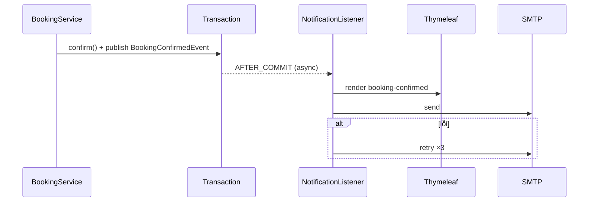

# [FD-NTF-01] Gửi email thông báo đặt phòng (Send Booking Email)

## 0. Thông tin tài liệu

| Mục | Nội dung |
|---|---|
| Mã chức năng | FD-NTF-01 |
| Tên | Gửi email thông báo đặt phòng (Send Booking Email) |
| Module | NTF |
| Version | v0.1 |
| Trạng thái | Draft |
| Người viết | B |
| Người duyệt | A (kỹ thuật) · PO (nghiệp vụ) |
| Owner | BE: B · FE: – |
| Task | KTV-46 |

| Version | Ngày | Người | Nội dung |
|---|---|---|---|
| v0.1 | 2026-10-21 | B | Tạo mới |

## 1. Tổng quan

- **Mục đích:** Thông báo cho khách mọi thay đổi quan trọng của đơn qua email, giúp khách yên tâm và nhớ lịch.
- **Phạm vi:** các loại email ở §2.6, gửi bất đồng bộ sau khi transaction commit.
- **Actor:** Hệ thống.
- **Ưu tiên:** Should.
- **Tham chiếu:** C12 · FD-BKG-05, FD-PAY-02, FD-BKG-07, FD-BKG-08, FD-BKG-09, FD-AUTH-04.

## 2. Mô tả nghiệp vụ

### 2.1 Tiền điều kiện
- Đơn có email người nhận (`users.email`). Walk-in không có tài khoản → không gửi.

### 2.2 Hậu điều kiện
- Email được gửi (hoặc ghi log lỗi sau 3 lần thử). **Lỗi gửi email không làm hỏng nghiệp vụ.**

### 2.3 Luồng chính
1. Service nghiệp vụ publish domain event (VD: `BookingConfirmedEvent`).
2. `NotificationListener` (`@TransactionalEventListener(AFTER_COMMIT)` + `@Async`) nhận event.
3. Tải dữ liệu đơn, render template Thymeleaf tương ứng.
4. Gửi qua `JavaMailSender`; lỗi → thử lại tối đa 3 lần (backoff 5s, 30s, 2 phút).
5. Log kết quả.

### 2.4 Luồng thay thế / ngoại lệ

| Mã | Tại bước | Điều kiện | Xử lý |
|---|---|---|---|
| A1 | 1 | Không có email | Bỏ qua, log DEBUG |
| E1 | 4 | SMTP lỗi sau 3 lần | Log ERROR kèm mã đơn; không retry tiếp |

### 2.6 Danh sách email

| Mã template | Kích hoạt bởi | Tiêu đề | Nội dung chính |
|---|---|---|---|
| `booking-confirmed` | BKG-05 (CASH), PAY-02 | [KTV] Xác nhận đặt phòng {code} | Chi nhánh, địa chỉ, phòng, giờ, món, tổng, đã thanh toán / trả tại quầy, chính sách hủy, lưu ý no-show (CASH), link SCR-C12 |
| `booking-cancelled` | BKG-07, BKG-09 | [KTV] Đơn {code} đã hủy | Lý do, số tiền hoàn (nếu có), thời gian xử lý hoàn |
| `booking-no-show` | BKG-08 | [KTV] Đơn {code} đã tự hủy | Do không check-in sau 15' |
| `payment-late-refund` | PAY-02 (A1) | [KTV] Thanh toán đơn {code} sẽ được hoàn | Xin lỗi, phòng đã có người khác, hoàn 100% |
| `password-reset` | AUTH-04 | [KTV] Đặt lại mật khẩu | Link (30 phút) |

## 3. Giao diện
- Email HTML responsive, có bản text thay thế. Mẫu thiết kế: **TODO** (đồng bộ màu với UI).

## 4. Thiết kế xử lý

### 4.2 Các bước xử lý
```java
@TransactionalEventListener(phase = AFTER_COMMIT)
@Async("mailExecutor")
@Retryable(maxAttempts = 3, backoff = @Backoff(delay = 5000, multiplier = 6))
public void onBookingConfirmed(BookingConfirmedEvent e) { ... }
```
- Template: `resources/templates/email/*.html`.
- Cấu hình: dev = Mailtrap; prod = Gmail SMTP (App Password) – `MAIL_USERNAME`, `MAIL_PASSWORD`.
- Thời gian hiển thị theo `Asia/Ho_Chi_Minh`, tiền định dạng `918.000đ`.

### 4.3 Sequence diagram



### 4.4 Dữ liệu tác động

| Bảng | C | R | U | D |
|---|---|---|---|---|
| bookings, users, rooms, branches, booking_items, payments | | ✓ | | |

## 5. Bảo mật & phân quyền
- Không đưa token / mật khẩu vào log; link trong email trỏ tới `FRONTEND_URL`.

## 6. Yêu cầu phi chức năng
- Không làm chậm API (async). Email đến trong ≤ 1 phút (môi trường bình thường).

## 7. Tiêu chí nghiệm thu

| Mã | Given | When | Then |
|---|---|---|---|
| AC-NTF-01-01 | – | Confirm CASH | Mailtrap nhận `booking-confirmed` đúng thông tin |
| AC-NTF-01-02 | SMTP sai cấu hình | Confirm | Đơn vẫn CONFIRMED; log ERROR sau 3 lần |
| AC-NTF-01-03 | Walk-in | Check-out | Không gửi email |
| AC-NTF-01-04 | – | Hủy đơn VNPay còn 5h | Email có "hoàn 50%" và số tiền |

## 8. Vấn đề mở / Giả định

| # | Nội dung | Loại | Người xử lý | Trạng thái |
|---|---|---|---|---|
| 1 | Email nhắc lịch trước 2 giờ – ngoài phạm vi (có thể thêm nếu dư thời gian) | Giả định | PO | Open |
| 2 | Không lưu bảng lịch sử email (chỉ log) | Giả định | B | Open |

## 9. Phê duyệt

| Vai trò | Người | Ngày | Kết quả |
|---|---|---|---|
| Tech Lead | A | | |
| PO / Trưởng nhóm | | | |
