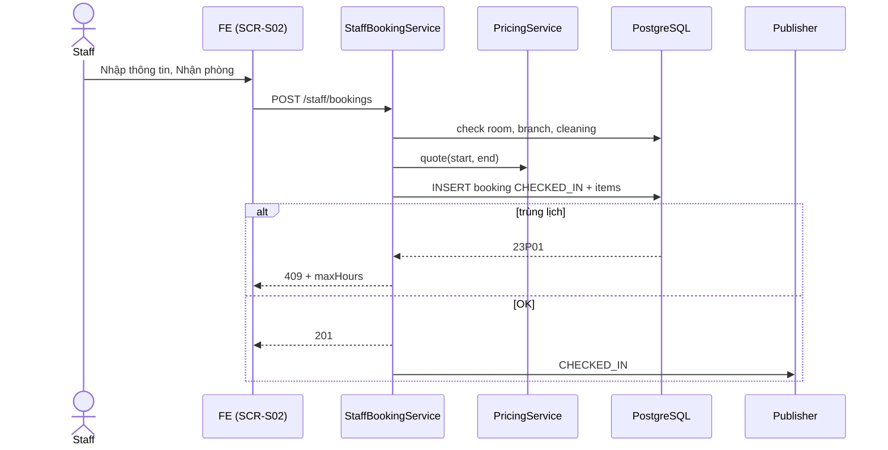

# [FD-OPS-02] Tạo đặt phòng cho khách vãng lai (Create Walk-in Booking)

## 0. Thông tin tài liệu

| Mục | Nội dung |
|---|---|
| Mã chức năng | FD-OPS-02 |
| Tên | Tạo đặt phòng cho khách vãng lai (Create Walk-in Booking) |
| Module | OPS |
| Version | v0.1 |
| Trạng thái | Draft |
| Người viết | B |
| Người duyệt | A (kỹ thuật) · PO (nghiệp vụ) |
| Owner | BE: B · FE: D |
| Task | KTV-45, KTV-50 |

| Version | Ngày | Người | Nội dung |
|---|---|---|---|
| v0.1 | 2026-10-21 | B | Tạo mới |

## 1. Tổng quan

- **Mục đích:** Phục vụ khách đến trực tiếp không đặt trước: nhân viên tạo đơn và cho vào phòng ngay.
- **Phạm vi:** tạo booking `CHECKED_IN` ngay, không cần tài khoản khách. **Ngoài phạm vi:** khách vãng lai đặt cho giờ sau (dùng luồng online hoặc ngoài phạm vi).
- **Actor:** Staff.
- **Ưu tiên:** Must.
- **Tham chiếu:** S02 · BR-01, BR-04→BR-06, BR-08, BR-20 · 01-business §6.2 · SCR-S02 · FD-OPS-01, FD-PRC-01, FD-OPS-04, FD-OPS-06.

## 2. Mô tả nghiệp vụ

### 2.1 Tiền điều kiện
- Đăng nhập `STAFF` có chi nhánh; phòng thuộc chi nhánh, `ACTIVE`, đang trống.

### 2.2 Hậu điều kiện
- Booking `CHECKED_IN`, `user_id = null`, `guest_name`, `guest_phone`, `payment_method = CASH`, `checked_in_at = now`; phòng 🔴 trên sơ đồ.

### 2.3 Luồng chính
1. Nhân viên bấm **"Khách vãng lai"** hoặc vùng trống trên timeline → mở SCR-S02.
2. Nhập: phòng, số giờ, số người, tên khách, SĐT; (tùy chọn) món.
3. FE hiển thị giá dự tính (PRC-01) và giờ kết thúc.
4. Nhân viên bấm **"Nhận phòng"**.
5. Hệ thống tính `start = now` **làm tròn tới mốc 30' gần nhất** (19:14 → 19:00, 19:16 → 19:30), `end = start + hours`.
6. Validate BR-01, BR-04, `end ≤ giờ đóng cửa`, phòng không trong thời gian dọn (`checked_out_at + 15' > now`).
7. Tính giá, insert booking `CHECKED_IN` (exclusion constraint bảo vệ trùng).
8. Sau commit: WS `CHECKED_IN`; FE chuyển SCR-S03.

### 2.4 Luồng thay thế / ngoại lệ

| Mã | Tại bước | Điều kiện | Xử lý |
|---|---|---|---|
| E1 | 7 | Phòng vướng đơn khác (VD: có đơn online 20:00) | 409 `ROOM_NOT_AVAILABLE` + `details.maxHours` (số giờ tối đa có thể nhận) |
| E2 | 6 | Phòng đang dọn | 409 `ROOM_NOT_AVAILABLE` – "Phòng đang dọn, sẵn sàng lúc {time}" |
| E3 | 6 | Vượt giờ đóng cửa | 400 |
| E4 | 6 | Phòng không thuộc chi nhánh staff | 403 |

### 2.6 Quy tắc nghiệp vụ áp dụng
- BR-01 (thời lượng), BR-04 (sức chứa), BR-05/06 (không trùng, buffer), BR-20 (giá). **Không** áp BR-02 (+30'), BR-03, BR-07.

## 3. Giao diện

- **Màn hình:** SCR-S02 (modal) – **Wireframe: TODO**

### 3.1 Danh sách item

| No | Item | Loại | Bắt buộc | Mặc định | Validate |
|---|---|---|---|---|---|
| 1 | Phòng | Select (chỉ phòng trống) | ✓ | Phòng được bấm | |
| 2 | Số giờ | Select | ✓ | 2 | 1–6, bước 0.5; tối đa `maxHours` của phòng |
| 3 | Số người | InputNumber | ✓ | 4 | ≤ sức chứa |
| 4 | Tên khách | Input | ✓ | "Khách lẻ" | ≤ 100 |
| 5 | SĐT | Input | ✗ | – | Regex SĐT VN |
| 6 | Món | Item picker | ✗ | – | Như OPS-04 |
| 7 | Tạm tính | Text | – | – | Giờ kết thúc + tiền phòng + món |

## 4. Thiết kế xử lý

### 4.1 API

| Mục | Giá trị |
|---|---|
| Endpoint | `POST /api/v1/staff/bookings` |
| Quyền | `STAFF` |
| Transaction | Có |

**Request**
```json
{ "roomId": 5, "hours": 2, "people": 4, "guestName": "Anh Tuấn", "guestPhone": "0912345678",
  "items": [ { "menuItemId": 3, "quantity": 1 } ] }
```
**Response 201** – booking chi tiết (`status: CHECKED_IN`).

### 4.2 Các bước xử lý
```
1. room = findRoom(roomId); check room.branchId == staff.branchId; ACTIVE
2. start = roundToNearest30(now); end = start + hours
3. check cleaning: exists COMPLETED where room & checked_out_at + 15m > now → ROOM_NOT_AVAILABLE
4. quote = pricing.quote(room.type, start, end)
5. insert booking(status=CHECKED_IN, checkedInAt=now, paymentMethod=CASH, guest..., roomAmount)
   catch 23P01 → ROOM_NOT_AVAILABLE (+ maxHours = khoảng trống tới booking kế tiếp)
6. insert items (unit_price chốt); fnb_amount; total
7. events: RoomStatus(CHECKED_IN)
```

### 4.3 Sequence diagram



### 4.4 Dữ liệu tác động

| Bảng | C | R | U | D |
|---|---|---|---|---|
| bookings | ✓ | ✓ | | |
| booking_items | ✓ | | | |
| rooms, menu_items, price_rules | | ✓ | | |

## 5. Bảo mật & phân quyền
- Staff chỉ tạo cho phòng thuộc chi nhánh mình.

## 6. Yêu cầu phi chức năng
- Thao tác hoàn tất ≤ 30 giây (tối đa 2 màn hình).

## 7. Tiêu chí nghiệm thu

| Mã | Given | When | Then |
|---|---|---|---|
| AC-OPS-02-01 | P05 trống, 19:14 | Tạo walk-in 2h | `start=19:00`, `end=21:00`, `CHECKED_IN` |
| AC-OPS-02-02 | P05 có đơn online 20:30 | Walk-in 2h lúc 19:00 | 409, `maxHours=1` |
| AC-OPS-02-03 | P05 vừa check-out 5' trước | Walk-in | 409 "đang dọn" |
| AC-OPS-02-04 | Staff chi nhánh 1 | Tạo cho phòng chi nhánh 2 | 403 |

## 8. Vấn đề mở / Giả định

| # | Nội dung | Loại | Người xử lý | Trạng thái |
|---|---|---|---|---|
| 1 | Quy tắc làm tròn giờ bắt đầu tới 30' gần nhất | Giả định | PO | Open |

## 9. Phê duyệt

| Vai trò | Người | Ngày | Kết quả |
|---|---|---|---|
| Tech Lead | A | | |
| PO / Trưởng nhóm | | | |
