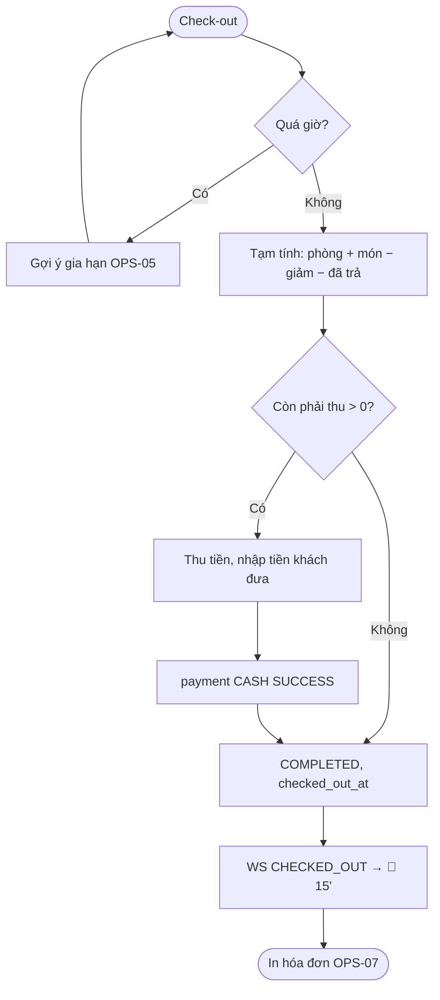

# [FD-OPS-06] Check-out và thu tiền (Check Out)

## 0. Thông tin tài liệu

| Mục | Nội dung |
|---|---|
| Mã chức năng | FD-OPS-06 |
| Tên | Check-out và thu tiền (Check Out) |
| Module | OPS |
| Version | v0.1 |
| Trạng thái | Draft |
| Người viết | B |
| Người duyệt | A (kỹ thuật) · PO (nghiệp vụ) |
| Owner | BE: B · FE: D |
| Task | KTV-45, KTV-50 |

| Version | Ngày | Người | Nội dung |
|---|---|---|---|
| v0.1 | 2026-10-21 | B | Tạo mới |

## 1. Tổng quan

- **Mục đích:** Kết thúc phiên hát: tổng hợp toàn bộ chi phí, thu phần còn thiếu, đóng đơn và trả phòng về trạng thái dọn dẹp.
- **Phạm vi:** tổng hợp hóa đơn, ghi nhận thu tiền mặt, chuyển `COMPLETED`. In hóa đơn ở OPS-07.
- **Actor:** Staff.
- **Ưu tiên:** Must.
- **Tham chiếu:** S03, S06 · BR-23, BR-43, BR-63, BR-64 · 01-business §6.3 · SCR-S03 · FD-OPS-04, FD-OPS-05, FD-OPS-07, FD-REV-01, FD-ROM-03.

## 2. Mô tả nghiệp vụ

### 2.1 Tiền điều kiện
- Đơn `CHECKED_IN`, cùng chi nhánh.

### 2.2 Hậu điều kiện
- Đơn `COMPLETED`, `checked_out_at = now`.
- Nếu còn nợ: 1 payment `CASH` `SUCCESS` với số tiền còn lại.
- Phòng 🔵 dọn dẹp 15' rồi 🟢 (BR-64).
- Khách có tài khoản → được phép đánh giá (REV-01).

### 2.3 Luồng chính
1. Nhân viên bấm **"Check-out"** trên SCR-S03.
2. Hệ thống trả bản **tạm tính**: tiền phòng (gồm gia hạn), đồ ăn uống (đặt trước + gọi thêm), giảm giá, tổng, **đã thanh toán**, **còn phải thu**.
3. Nhân viên thu tiền mặt / chuyển khoản tại quầy, nhập **số tiền khách đưa** → FE tính tiền thối.
4. Nhân viên bấm **"Xác nhận thanh toán & trả phòng"**.
5. Hệ thống ghi payment (nếu còn phải thu > 0), chuyển `COMPLETED`.
6. Sau commit: WS `CHECKED_OUT`; FE mở OPS-07 (in hóa đơn).

### 2.4 Luồng thay thế / ngoại lệ

| Mã | Tại bước | Điều kiện | Xử lý |
|---|---|---|---|
| A1 | 2 | Đã trả đủ qua VNPay, không gọi thêm | Còn phải thu = 0 → bỏ bước 3 |
| A2 | 1 | Khách về sớm | Cho phép, không hoàn tiền giờ chưa dùng (BR-63) |
| A3 | 1 | Quá `end_time` mà chưa gia hạn | Cảnh báo "Quá giờ {x} phút" + gợi ý Gia hạn (OPS-05) trước khi check-out |
| E1 | 4 | Số tiền khách đưa < còn phải thu | FE chặn |
| E2 | 5 | Đơn đã `COMPLETED` (bấm 2 lần) | 422 `INVALID_STATE` – FE mở hóa đơn |

### 2.5 Activity diagram



### 2.6 Quy tắc nghiệp vụ áp dụng
- **BR-23** công thức tổng · **BR-43** món gọi thêm + gia hạn trả khi check-out · **BR-63** về sớm không hoàn · **BR-64** dọn 15'.

## 3. Giao diện

- **Màn hình:** SCR-S03 – modal check-out – **Wireframe: TODO**

### 3.1 Danh sách item

| No | Item | Loại | Ghi chú |
|---|---|---|---|
| 1 | Bảng chi phí | Table | Tiền phòng (breakdown), từng món, giảm giá |
| 2 | Tổng / Đã trả / **Còn phải thu** | Statistic | Còn phải thu in đậm |
| 3 | Tiền khách đưa | InputNumber | Gợi ý nhanh: đúng số, làm tròn 50k / 100k / 500k |
| 4 | Tiền thối | Text | `= đưa − còn phải thu` |
| 5 | Nút xác nhận | Button | Disable nếu tiền đưa < còn phải thu |

## 4. Thiết kế xử lý

### 4.1 API

| Method | Endpoint | Mô tả |
|---|---|---|
| GET | `/api/v1/staff/bookings/{id}/invoice` | Tạm tính (dùng chung OPS-07) |
| POST | `/api/v1/staff/bookings/{id}/check-out` `{ "receivedAmount": 500000 }` | Xác nhận |

**Response check-out**
```json
{ "success": true, "data": { "status": "COMPLETED", "total": 1218000, "paidBefore": 918000,
  "collected": 300000, "receivedAmount": 500000, "change": 200000 } }
```

### 4.2 Các bước xử lý
```
b = findByIdForUpdate(id); check CHECKED_IN, branch
total = round1000(roomAmount + fnbAmount − discount)
paid = Σ payments SUCCESS (trừ refund)
due = max(total − paid, 0)
if due > 0: require receivedAmount ≥ due; insert payment(CASH, due, SUCCESS, paidAt=now)
b.status = COMPLETED; b.checkedOutAt = now
publish RoomStatus(CHECKED_OUT)
```
- `receivedAmount` / `change` chỉ trả về để in, không lưu DB.

### 4.3 Sequence diagram

```mermaid
sequenceDiagram
  actor S as Staff
  participant FE as FE (SCR-S03)
  participant OS as StaffBookingService
  participant DB as PostgreSQL
  participant WS as Publisher
  S->>FE: Check-out
  FE->>OS: GET /invoice
  OS->>DB: booking + items + payments
  OS-->>FE: tạm tính (due)
  S->>FE: Nhập tiền khách đưa, xác nhận
  FE->>OS: POST /check-out
  OS->>DB: INSERT payment CASH (due) ; UPDATE COMPLETED
  OS-->>FE: 200
  OS->>WS: CHECKED_OUT
  FE->>S: Mở hóa đơn (OPS-07)
```

### 4.4 Dữ liệu tác động

| Bảng | C | R | U | D |
|---|---|---|---|---|
| bookings | | ✓ | ✓ | |
| payments | ✓ | ✓ | | |
| booking_items | | ✓ | | |

## 5. Bảo mật & phân quyền
- Cùng chi nhánh; tổng tiền tính ở server.

## 6. Yêu cầu phi chức năng
- Idempotent theo trạng thái (bấm 2 lần không tạo 2 payment).

## 7. Tiêu chí nghiệm thu

| Mã | Given | When | Then |
|---|---|---|---|
| AC-OPS-06-01 | VNPay đã trả 918k, gọi thêm 300k | Check-out, khách đưa 500k | payment CASH 300k, thối 200k, `COMPLETED` |
| AC-OPS-06-02 | CASH, chưa trả, tổng 480k | Check-out | payment CASH 480k |
| AC-OPS-06-03 | Đã trả đủ | Check-out | Không tạo payment |
| AC-OPS-06-04 | – | Bấm xác nhận 2 lần | Lần 2: 422, chỉ 1 payment |
| AC-OPS-06-05 | Khách khác xem sơ đồ | Check-out | Phòng 🔵 rồi 🟢 sau 15' (staff); khách thấy 🟢 |

## 8. Vấn đề mở / Giả định

| # | Nội dung | Loại | Người xử lý | Trạng thái |
|---|---|---|---|---|
| 1 | Chuyển khoản tại quầy ghi nhận như `CASH` (không phân biệt) | Giả định | PO | Open |
| 2 | Đơn VNPay đã trả nhưng về sớm → không hoàn (BR-63) | Xác nhận | PO | Closed |

## 9. Phê duyệt

| Vai trò | Người | Ngày | Kết quả |
|---|---|---|---|
| Tech Lead | A | | |
| PO / Trưởng nhóm | | | |
