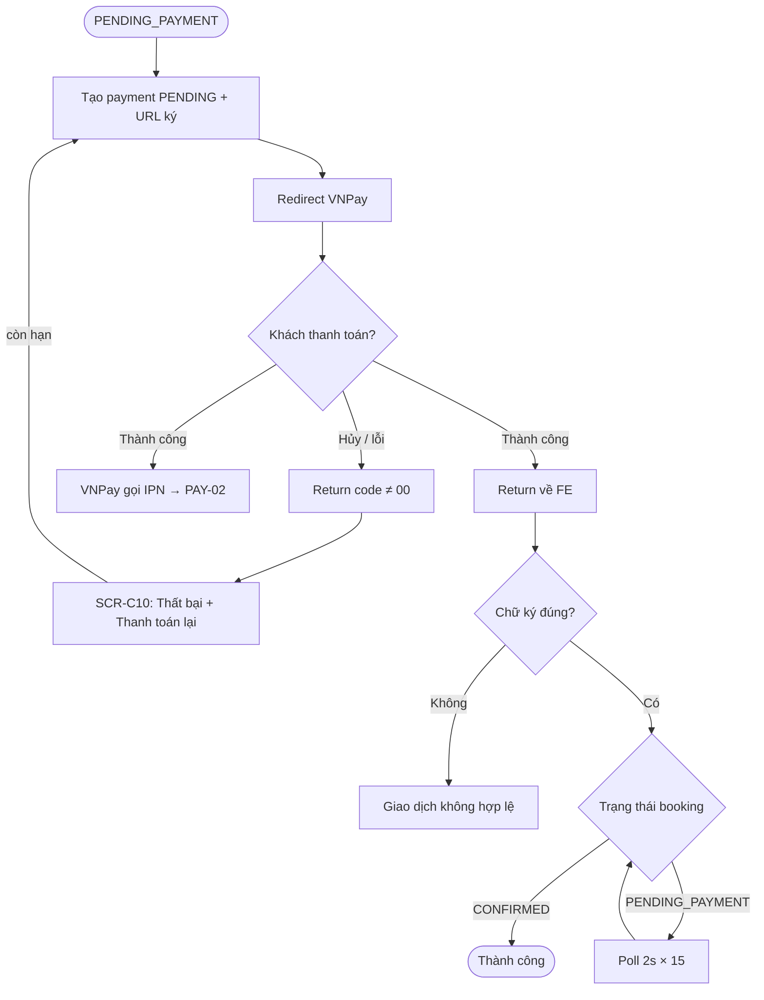
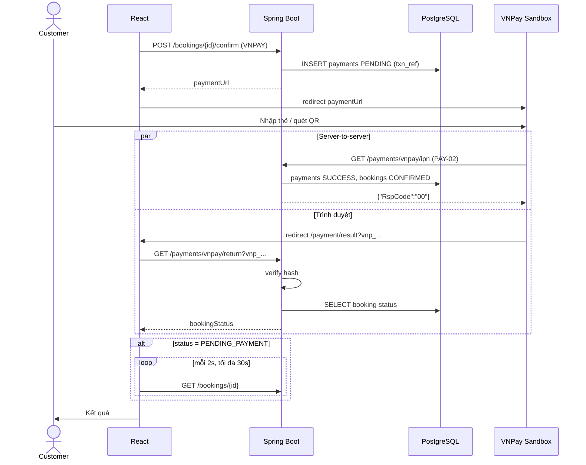

# [FD-PAY-01] Thanh toán qua VNPay (Pay via VNPay)

## 0. Thông tin tài liệu

| Mục | Nội dung |
|---|---|
| Mã chức năng | FD-PAY-01 |
| Tên | Thanh toán qua VNPay (Pay via VNPay) |
| Module | PAY |
| Version | v0.1 |
| Trạng thái | Draft |
| Người viết | A |
| Người duyệt | A (kỹ thuật) · PO (nghiệp vụ) |
| Owner | BE: A · FE: C |
| Task | KTV-40, KTV-49 |

| Version | Ngày | Người | Nội dung |
|---|---|---|---|
| v0.1 | 2026-10-21 | A | Tạo mới |

## 1. Tổng quan

- **Mục đích:** Cho khách thanh toán trước toàn bộ đơn qua cổng VNPay (thẻ ATM / QR / Visa), giảm tỷ lệ khách không đến.
- **Phạm vi:** tạo URL thanh toán có chữ ký, thanh toán lại khi chưa hết hạn, xử lý trang return (chỉ hiển thị). **Ngoài phạm vi:** cập nhật trạng thái đơn (PAY-02 qua IPN), hoàn tiền thật.
- **Actor:** Customer (chính) · VNPay Sandbox (phụ).
- **Ưu tiên:** Should.
- **Tham chiếu:** C09 · BR-40, BR-42, BR-44 · SCR-C09, SCR-C10 · FD-BKG-05, FD-PAY-02, FD-BKG-03.

## 2. Mô tả nghiệp vụ

### 2.1 Tiền điều kiện
- Booking ở `PENDING_PAYMENT`, `hold_expires_at > now` (được tạo bởi BKG-05).
- Cấu hình `VNPAY_TMN_CODE`, `VNPAY_HASH_SECRET`, `VNPAY_RETURN_URL` hợp lệ.

### 2.2 Hậu điều kiện
- **Thành công (tạo URL):** 1 bản ghi `payments` `PENDING` với `txn_ref` duy nhất; khách ở trang VNPay.
- **Sau khi khách quay về:** SCR-C10 hiển thị kết quả **theo trạng thái trong DB** (do IPN cập nhật).

### 2.3 Luồng chính
1. (Từ BKG-05) Hệ thống tạo payment `PENDING`, sinh `txn_ref`, build URL VNPay có chữ ký HMAC-SHA512.
2. FE chuyển trình duyệt sang `paymentUrl`.
3. Khách thanh toán trên VNPay sandbox.
4. VNPay gọi IPN về server (PAY-02) **và** redirect trình duyệt về `VNPAY_RETURN_URL` (= FE `/payment/result`).
5. FE gửi nguyên query string tới `GET /payments/vnpay/return`.
6. Hệ thống kiểm tra chữ ký, tìm payment theo `vnp_TxnRef`, trả trạng thái booking hiện tại.
7. Nếu booking vẫn `PENDING_PAYMENT` (IPN chưa tới) → FE poll `GET /bookings/{id}` mỗi 2 giây, tối đa 30 giây.
8. FE hiển thị: ✅ thành công (`CONFIRMED`) / ❌ thất bại / ⏳ đang xử lý.

### 2.4 Luồng thay thế / ngoại lệ

| Mã | Tại bước | Điều kiện | Xử lý |
|---|---|---|---|
| A1 | 3 | Khách bấm "Hủy giao dịch" trên VNPay | Return với `vnp_ResponseCode=24`; booking vẫn `PENDING_PAYMENT` → SCR-C10 hiện nút **"Thanh toán lại"** |
| A2 | – | Thanh toán lại | `POST /payments/vnpay/create` → payment cũ `FAILED`, tạo payment mới + URL mới (cùng `hold_expires_at`) |
| E1 | 6 | Chữ ký sai | 400 `INVALID_SIGNATURE` – SCR-C10 "Giao dịch không hợp lệ" |
| E2 | A2 | Đã hết hạn 15' / booking không còn `PENDING_PAYMENT` | 410 `HOLD_EXPIRED` |
| E3 | 7 | Poll quá 30 giây vẫn chưa có IPN | Hiển thị "Đang xác nhận, kết quả sẽ gửi qua email" + link SCR-C12 |

### 2.5 Activity diagram



### 2.6 Quy tắc nghiệp vụ áp dụng
- **BR-40:** thanh toán toàn bộ trước. **BR-42:** chỉ tin IPN, trang return chỉ để hiển thị. **BR-44:** hạn 15 phút.

## 3. Giao diện

- **Màn hình:** SCR-C10 – **Wireframe: TODO**

### 3.1 Danh sách item (SCR-C10)

| No | Item | Loại | Ghi chú |
|---|---|---|---|
| 1 | Icon + tiêu đề kết quả | Result | success / error / info (đang xử lý) |
| 2 | Mã đơn, số tiền, mã giao dịch VNPay | Descriptions | `vnp_TransactionNo` |
| 3 | Nút "Xem đơn" | Button | → SCR-C12 |
| 4 | Nút "Thanh toán lại" | Button | Chỉ khi thất bại và còn hạn |
| 5 | Đồng hồ còn lại | Countdown | Khi thất bại và còn hạn |

### 3.3 Thông báo

| Mã | Điều kiện | Nội dung |
|---|---|---|
| MSG-PAY-01 | Thành công | "Thanh toán thành công! Email xác nhận đã được gửi." |
| MSG-PAY-02 | Thất bại | "Thanh toán chưa thành công. Bạn còn {mm:ss} để thử lại." |
| MSG-PAY-03 | E3 | "Hệ thống đang xác nhận giao dịch. Kết quả sẽ được gửi qua email." |

## 4. Thiết kế xử lý

### 4.1 API

| Endpoint | Quyền | Mô tả |
|---|---|---|
| (nội bộ) `VnPayService.createPayment(booking, ip)` | – | Gọi từ BKG-05 |
| `POST /api/v1/payments/vnpay/create` `{ "bookingId": 1024 }` | `CUSTOMER` (chủ) | Thanh toán lại → `{ paymentUrl, paymentExpiresAt }` |
| `GET /api/v1/payments/vnpay/return?vnp_...` | Public | Kiểm tra chữ ký → `{ bookingId, bookingStatus, responseCode, amount }` |

### 4.2 Các bước xử lý – build URL

| Tham số | Giá trị |
|---|---|
| `vnp_Version` | `2.1.0` |
| `vnp_Command` | `pay` |
| `vnp_TmnCode` | env `VNPAY_TMN_CODE` |
| `vnp_Amount` | `total × 100` |
| `vnp_CurrCode` | `VND` |
| `vnp_TxnRef` | `{bookingId}T{attempt}` – VD `1024T1` (unique trong `payments.txn_ref`) |
| `vnp_OrderInfo` | `Thanh toan don KTV-20261028-0007` (không dấu) |
| `vnp_OrderType` | `other` |
| `vnp_Locale` | `vn` |
| `vnp_ReturnUrl` | env `VNPAY_RETURN_URL` |
| `vnp_IpAddr` | IP client (`X-Forwarded-For` nếu sau proxy) |
| `vnp_CreateDate` | `yyyyMMddHHmmss` theo GMT+7 |
| `vnp_ExpireDate` | = `hold_expires_at` (định dạng như trên) |
| `vnp_SecureHash` | HMAC-SHA512(`VNPAY_HASH_SECRET`, query đã sort theo key + URL-encode) |

```
createPayment(booking, ip):
  attempt = payments.countByBooking(booking.id) + 1
  payments.markPendingAsFailed(booking.id)
  p = payments.insert(method=VNPAY, amount=booking.total, status=PENDING, txnRef=booking.id+"T"+attempt)
  return VnPayUrlBuilder.build(params, secret)
```

### 4.3 Sequence diagram



### 4.4 Dữ liệu tác động

| Bảng | C | R | U | D | Ghi chú |
|---|---|---|---|---|---|
| payments | ✓ | ✓ | ✓ | | PENDING mới; PENDING cũ → FAILED khi thanh toán lại |
| bookings | | ✓ | | | Return chỉ đọc |

### 4.5 Tích hợp
- VNPay Sandbox: `https://sandbox.vnpayment.vn/paymentv2/vpcpay.html`. Tài liệu: sandbox.vnpayment.vn/apis. Thẻ test NCB do VNPay cung cấp.

## 5. Bảo mật & phân quyền
- `VNPAY_HASH_SECRET` chỉ ở biến môi trường, không log.
- Endpoint return **không** thay đổi trạng thái (chống giả mạo query string).
- So sánh chữ ký bằng `MessageDigest.isEqual` (constant-time).

## 6. Yêu cầu phi chức năng
- Unit test `VnPayUrlBuilder` với bộ tham số mẫu, đối chiếu chữ ký từ công cụ VNPay.

## 7. Tiêu chí nghiệm thu

| Mã | Given | When | Then |
|---|---|---|---|
| AC-PAY-01-01 | Booking PENDING_PAYMENT 918k | Tạo URL | `vnp_Amount=91800000`, chữ ký hợp lệ (VNPay chấp nhận) |
| AC-PAY-01-02 | Thanh toán thẻ test thành công | Quay về FE | Hiển thị thành công sau ≤ 30s |
| AC-PAY-01-03 | Khách hủy trên VNPay | Quay về FE | Thất bại + nút "Thanh toán lại" |
| AC-PAY-01-04 | Thanh toán lại | Gọi create | payment cũ FAILED, có URL mới, `txn_ref` mới |
| AC-PAY-01-05 | Sửa `vnp_Amount` trên URL return | Gọi return | 400 `INVALID_SIGNATURE` |
| AC-PAY-01-06 | Quá 15' | Thanh toán lại | 410 |

## 8. Vấn đề mở / Giả định

| # | Nội dung | Loại | Người xử lý | Trạng thái |
|---|---|---|---|---|
| 1 | Mã lỗi mới `INVALID_SIGNATURE` (400) | Bổ sung | A | Đã thêm |
| 2 | IPN cần URL public – môi trường local dùng ngrok / cloudflared | Rủi ro | A | Open |

## 9. Phê duyệt

| Vai trò | Người | Ngày | Kết quả |
|---|---|---|---|
| Tech Lead | A | | |
| PO / Trưởng nhóm | | | |
