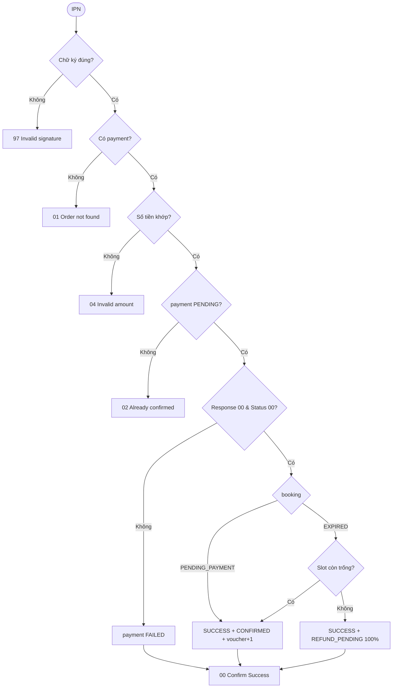
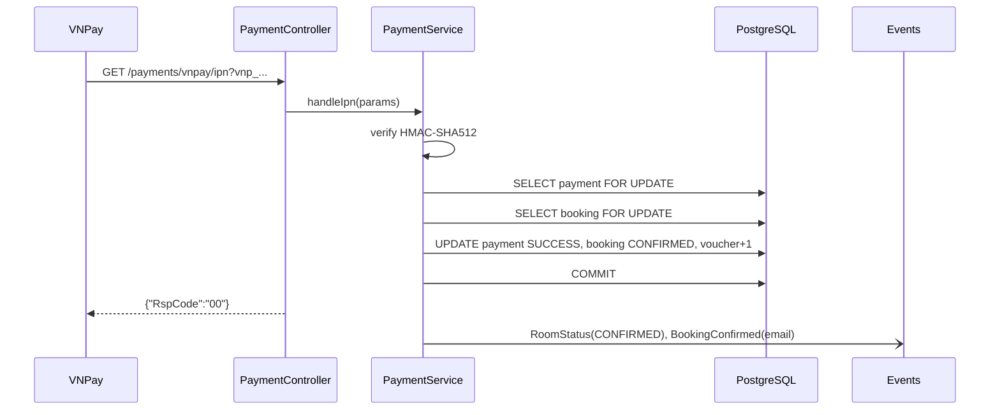

# [FD-PAY-02] Xử lý kết quả thanh toán VNPay – IPN (Process VNPay IPN)

## 0. Thông tin tài liệu

| Mục | Nội dung |
|---|---|
| Mã chức năng | FD-PAY-02 |
| Tên | Xử lý kết quả thanh toán VNPay (Process VNPay IPN) |
| Module | PAY |
| Version | v0.1 |
| Trạng thái | Draft |
| Người viết | A |
| Người duyệt | A (kỹ thuật) · PO (nghiệp vụ) |
| Owner | BE: A · FE: – |
| Task | KTV-40, KTV-65 |

| Version | Ngày | Người | Nội dung |
|---|---|---|---|
| v0.1 | 2026-10-21 | A | Tạo mới |

## 1. Tổng quan

- **Mục đích:** Nhận kết quả giao dịch từ VNPay theo kênh server-to-server (đáng tin cậy) và cập nhật trạng thái đơn – nguồn sự thật duy nhất cho thanh toán online.
- **Phạm vi:** xác thực chữ ký, đối chiếu số tiền, cập nhật payment + booking, idempotent, xử lý IPN đến muộn.
- **Actor:** VNPay (hệ thống ngoài).
- **Ưu tiên:** Should.
- **Tham chiếu:** BR-32, BR-40, BR-42, BR-44, BR-50 · FD-PAY-01, FD-BKG-03, FD-NTF-01, FD-ROM-03.

## 2. Mô tả nghiệp vụ

### 2.1 Tiền điều kiện
- Có payment với `txn_ref = vnp_TxnRef`.

### 2.2 Hậu điều kiện
- **Giao dịch thành công:** payment `SUCCESS` (`paid_at`, `raw_response`), booking `CONFIRMED`, voucher `used_count + 1`, email xác nhận, WS `CONFIRMED`.
- **Giao dịch thất bại:** payment `FAILED`; booking giữ `PENDING_PAYMENT` (khách còn thanh toán lại được tới khi hết hạn).
- Luôn trả JSON `{ RspCode, Message }` cho VNPay.

### 2.3 Luồng chính
1. VNPay gọi `GET /payments/vnpay/ipn?vnp_...`.
2. Hệ thống kiểm tra chữ ký → sai: trả `97`.
3. Tìm payment theo `vnp_TxnRef` (khóa `FOR UPDATE`) → không có: trả `01`.
4. So sánh `vnp_Amount / 100` với `payments.amount` → lệch: trả `04`.
5. Payment không còn `PENDING` → trả `02` (đã xử lý – idempotent).
6. Nếu `vnp_ResponseCode = 00` **và** `vnp_TransactionStatus = 00`:
   - Booking đang `PENDING_PAYMENT` → payment `SUCCESS`, booking `CONFIRMED`, `hold_expires_at = null`, tăng lượt voucher.
7. Ngược lại → payment `FAILED`.
8. Lưu `raw_response`; commit; trả `{"RspCode":"00","Message":"Confirm Success"}`.
9. Sau commit: phát WS, gửi email (chỉ khi thành công).

### 2.4 Luồng thay thế / ngoại lệ

| Mã | Tại bước | Điều kiện | Xử lý |
|---|---|---|---|
| A1 | 6 | **IPN đến muộn** – booking đã `EXPIRED` (job BKG-03 chạy trước) | Thử chuyển booking về `CONFIRMED`: nếu slot vẫn trống (constraint OK) → `CONFIRMED`; nếu vướng → payment `SUCCESS` + tạo refund 100% `REFUND_PENDING`, booking giữ `EXPIRED`, gửi email xin lỗi. Trả `00` |
| E1 | – | Exception bất ngờ | Rollback, trả `99` – VNPay sẽ gọi lại |

### 2.5 Activity diagram



### 2.6 Quy tắc nghiệp vụ áp dụng
- **BR-42:** IPN idempotent theo `txn_ref`. **BR-32:** tăng lượt voucher khi `CONFIRMED`. **BR-50:** refund chỉ ghi nhận.

## 3. Giao diện
Không có.

## 4. Thiết kế xử lý

### 4.1 API

| Mục | Giá trị |
|---|---|
| Endpoint | `GET /api/v1/payments/vnpay/ipn` |
| Quyền | Public (`permitAll`) – xác thực bằng chữ ký |
| Transaction | Có |

**Response (luôn HTTP 200)**

| RspCode | Message | Khi nào |
|---|---|---|
| `00` | Confirm Success | Đã xử lý (thành công hoặc thất bại) |
| `01` | Order not found | Không có `txn_ref` |
| `02` | Order already confirmed | Payment đã xử lý trước đó |
| `04` | Invalid amount | Lệch số tiền |
| `97` | Invalid signature | Sai chữ ký |
| `99` | Unknown error | Exception |

### 4.2 Các bước xử lý
```
handleIpn(params):
  if !signer.verify(params) → 97
  p = payments.findByTxnRefForUpdate(params.vnp_TxnRef) ?: → 01
  if params.vnp_Amount/100 != p.amount → 04
  if p.status != PENDING → 02
  p.rawResponse = params
  if params.vnp_ResponseCode=="00" && params.vnp_TransactionStatus=="00":
      p.status = SUCCESS; p.paidAt = now
      b = bookings.findByIdForUpdate(p.bookingId)
      if b.status == PENDING_PAYMENT: confirm(b)
      elif b.status == EXPIRED:
          try { b.status = CONFIRMED; flush() ; confirm side-effects }
          catch 23P01 { payments.insertRefund(b, p.amount); b.status stays EXPIRED; event ApologyEmail }
  else:
      p.status = FAILED
  → 00
```

### 4.3 Sequence diagram



### 4.4 Dữ liệu tác động

| Bảng | C | R | U | D | Ghi chú |
|---|---|---|---|---|---|
| payments | ✓ | ✓ | ✓ | | refund khi A1 |
| bookings | | ✓ | ✓ | | |
| vouchers | | | ✓ | | |

## 5. Bảo mật & phân quyền
- Endpoint public nhưng **mọi xử lý chỉ sau khi chữ ký hợp lệ**.
- (Tùy chọn) whitelist IP VNPay sandbox qua cấu hình.
- Log `raw_response` (không chứa dữ liệu thẻ).

## 6. Yêu cầu phi chức năng
- Phản hồi VNPay < 2 giây; email/WS chạy sau commit, bất đồng bộ.
- Integration test (Testcontainers): IPN gọi 2 lần → lần 2 trả `02`, không tăng voucher 2 lần.

## 7. Tiêu chí nghiệm thu

| Mã | Given | When | Then |
|---|---|---|---|
| AC-PAY-02-01 | Payment PENDING, booking PENDING_PAYMENT | IPN thành công | `00`; booking CONFIRMED; email gửi |
| AC-PAY-02-02 | Đã xử lý thành công | IPN gửi lại | `02`; không thay đổi dữ liệu |
| AC-PAY-02-03 | – | IPN sai chữ ký | `97` |
| AC-PAY-02-04 | – | `vnp_Amount` lệch | `04` |
| AC-PAY-02-05 | IPN thất bại (`vnp_ResponseCode=51`) | Xử lý | payment FAILED, booking vẫn PENDING_PAYMENT |
| AC-PAY-02-06 | Booking EXPIRED, slot trống | IPN thành công muộn | booking CONFIRMED |
| AC-PAY-02-07 | Booking EXPIRED, slot đã có người khác | IPN thành công muộn | payment SUCCESS + refund 100%, booking EXPIRED |

## 8. Vấn đề mở / Giả định

| # | Nội dung | Loại | Người xử lý | Trạng thái |
|---|---|---|---|---|
| 1 | Cần URL public cho IPN khi dev (ngrok) – đăng ký URL IPN trên merchant sandbox | Rủi ro | A | Open |
| 2 | Không gọi API truy vấn giao dịch (`querydr`) để đối soát – ngoài phạm vi | Giả định | A | Open |

## 9. Phê duyệt

| Vai trò | Người | Ngày | Kết quả |
|---|---|---|---|
| Tech Lead | A | | |
| PO / Trưởng nhóm | | | |
