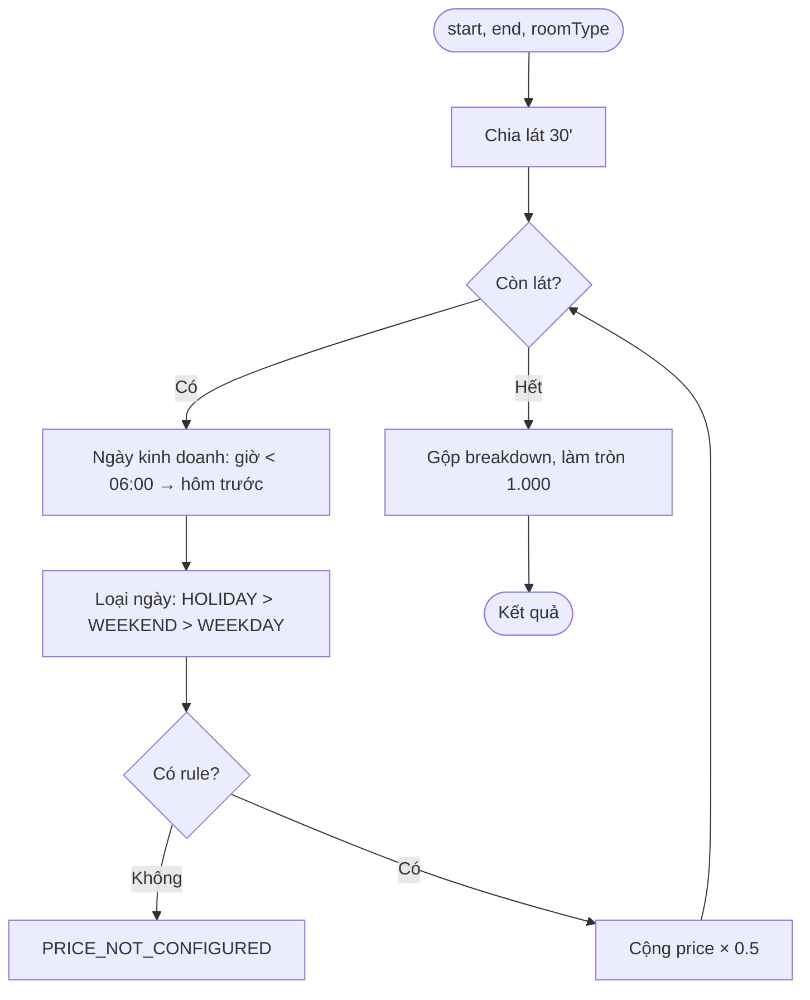

# [FD-PRC-01] Tính giá đặt phòng (Calculate Booking Price)

## 0. Thông tin tài liệu

| Mục | Nội dung |
|---|---|
| Mã chức năng | FD-PRC-01 |
| Tên | Tính giá đặt phòng (Calculate Booking Price) |
| Module | PRC |
| Version | v0.1 |
| Trạng thái | Draft |
| Người viết | B |
| Người duyệt | A (kỹ thuật) · PO (nghiệp vụ) |
| Owner | BE: B · FE: C |
| Task | KTV-21, KTV-22 |

| Version | Ngày | Người | Nội dung |
|---|---|---|---|
| v0.1 | 2026-10-21 | B | Tạo mới |

## 1. Tổng quan

- **Mục đích:** Tính chính xác tiền phòng cho một khoảng thời gian có thể trải qua nhiều khung giờ và nhiều loại ngày. Là service lõi dùng bởi tìm phòng, giữ chỗ, walk-in, gia hạn.
- **Phạm vi:** `PricingService.quote()` + API báo giá public. **Ngoài phạm vi:** voucher (VCH-01), đồ ăn uống.
- **Actor:** Hệ thống (chính) · Guest / Customer qua API báo giá.
- **Ưu tiên:** Must.
- **Tham chiếu:** BR-20→BR-24 · FD-ROM-02, FD-BKG-01, FD-OPS-02, FD-OPS-05, FD-PRC-02.

## 2. Mô tả nghiệp vụ

### 2.1 Tiền điều kiện
- Loại phòng có bảng giá phủ toàn bộ giờ mở cửa cho WEEKDAY và WEEKEND.

### 2.2 Hậu điều kiện
- Trả về tổng tiền + breakdown theo từng khung. Không ghi dữ liệu.

### 2.3 Luồng chính (thuật toán)
1. Nhận `roomTypeId`, `start`, `end` (đã validate bước 30 phút).
2. Chia `[start, end)` thành các **lát 30 phút**.
3. Với mỗi lát, xác định **ngày kinh doanh**: nếu giờ < 06:00 → thuộc ngày hôm trước (VD: 01:00 sáng thứ Bảy thuộc thứ Sáu).
4. Xác định **loại ngày** của ngày kinh doanh: `HOLIDAY` (có trong `holidays`) > `WEEKEND` (T7, CN) > `WEEKDAY`.
5. Tìm `price_rule` của loại phòng + loại ngày có khung giờ chứa giờ bắt đầu của lát (khung qua đêm khi `end_hour < start_hour`). Không có rule `HOLIDAY` → dùng `WEEKEND`.
6. Tiền lát = `price_per_hour × 0.5`.
7. Gộp các lát liên tiếp cùng rule thành 1 dòng breakdown.
8. Tổng = Σ, làm tròn đến 1.000đ (BR-23).

### 2.4 Luồng thay thế / ngoại lệ

| Mã | Tại bước | Điều kiện | Xử lý |
|---|---|---|---|
| E1 | 5 | Không có rule cho lát | Ném `PRICE_NOT_CONFIGURED` (422), log WARN kèm roomType + thời điểm |
| E2 | 1 | `end ≤ start` hoặc không bội số 30' | `VALIDATION_ERROR` |

### 2.5 Activity diagram



### 2.6 Quy tắc nghiệp vụ áp dụng
- **BR-20:** tổng theo từng khung. **BR-21:** khung mặc định. **BR-22:** mỗi loại phòng có bảng giá riêng (`price_rules.room_type_id`) – không dùng hệ số. **BR-24:** chốt giá khi tạo đơn.

**Ví dụ kiểm thử (giá Standard theo BR-21):**

| Đặt | Breakdown | Tổng |
|---|---|---|
| Thứ Tư 16:00–19:00 | 1h × 120k + 2h × 180k | **480.000** |
| Thứ Sáu 23:00–01:00 | 2h × 180k (01:00 thứ Bảy vẫn thuộc thứ Sáu) | **360.000** |
| Chủ nhật 14:30–16:00 | 1.5h × 220k | **330.000** |
| 02/09 (HOLIDAY) 20:00–22:00 | 2h × 250k | **500.000** |
| Thứ Tư 16:30–17:30 | 0.5h × 120k + 0.5h × 180k | **150.000** |

## 3. Giao diện
- Không có màn hình riêng. Kết quả hiển thị ở SCR-C07 (giá dự tính), SCR-C08, SCR-C09 (breakdown), SCR-S02.

## 4. Thiết kế xử lý

### 4.1 API

| Mục | Giá trị |
|---|---|
| Endpoint | `GET /api/v1/rooms/{id}/price-quote?start=2026-10-28T19:00:00%2B07:00&hours=2.5` |
| Quyền | Public |

**Response 200**
```json
{ "success": true, "data": {
  "roomId": 12, "start": "2026-10-28T19:00:00+07:00", "end": "2026-10-28T21:30:00+07:00",
  "breakdown": [ { "from": "19:00", "to": "21:30", "dayType": "WEEKDAY", "unitPrice": 270000, "hours": 2.5, "amount": 675000 } ],
  "total": 675000 } }
```

### 4.2 Interface service
```java
public interface PricingService {
  PriceQuote quote(Long roomTypeId, OffsetDateTime start, OffsetDateTime end);
}
record PriceQuote(BigDecimal total, List<PriceLine> breakdown) {}
record PriceLine(LocalTime from, LocalTime to, DayType dayType, BigDecimal unitPrice, BigDecimal hours, BigDecimal amount) {}
```
- Tính toán theo `ZoneId.of("Asia/Ho_Chi_Minh")`.
- Cache `price_rules` + `holidays` (Caffeine, TTL 5 phút, xóa cache khi PRC-02 thay đổi).
- Mốc ngày kinh doanh 06:00 cấu hình `app.pricing.business-day-start`.

### 4.4 Dữ liệu tác động

| Bảng | C | R | U | D |
|---|---|---|---|---|
| price_rules, holidays, rooms | | ✓ | | |

## 5. Bảo mật & phân quyền
- API báo giá public, chỉ đọc.

## 6. Yêu cầu phi chức năng
- `quote()` < 5ms (có cache). **Coverage ≥ 90%** cho `PricingService` (vượt NFR-07 vì là logic tiền).

## 7. Tiêu chí nghiệm thu

| Mã | Given | When | Then |
|---|---|---|---|
| AC-PRC-01-01 | Bảng giá mặc định | 5 ví dụ trong §2.6 | Đúng cột "Tổng" |
| AC-PRC-01-02 | Loại phòng thiếu rule 09:00–17:00 WEEKDAY | Báo giá 10:00 thứ Hai | 422 `PRICE_NOT_CONFIGURED` |
| AC-PRC-01-03 | Không có rule HOLIDAY | Báo giá ngày lễ | Dùng giá WEEKEND |
| AC-PRC-01-04 | – | `hours = 1.25` | 400 |

## 8. Vấn đề mở / Giả định

| # | Nội dung | Loại | Người xử lý | Trạng thái |
|---|---|---|---|---|
| 1 | BR-22: chọn **bảng giá riêng theo loại phòng**, bỏ hệ số ×1.5/×2 → cập nhật 01-business | Quyết định | B | Đã cập nhật |
| 2 | Mốc ngày kinh doanh 06:00 – cần PO xác nhận | Giả định | PO | Open |
| 3 | Khung giờ trong `price_rules` phải là bội số 30' – validate ở PRC-02 | Ràng buộc | B | Open |

## 9. Phê duyệt

| Vai trò | Người | Ngày | Kết quả |
|---|---|---|---|
| Tech Lead | A | | |
| PO / Trưởng nhóm | | | |
