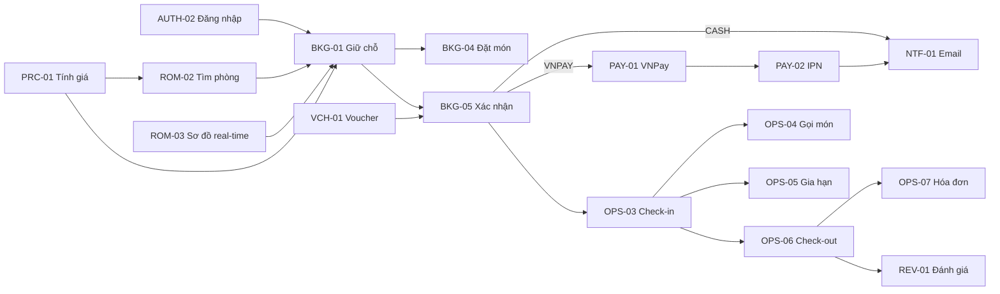

# Function Design – Mục lục

Tài liệu thiết kế chức năng (FD) của KTV Booking. Mỗi chức năng là **một file**, viết theo [\_template.md](_template.md).

Nguồn đầu vào: [01-business.md](../01-business.md) (tính năng C/S/A, quy tắc BR, NFR) · [02-architecture.md](../02-architecture.md) (dữ liệu, API, mã lỗi).

---

## 1. Quy ước đặt tên

### 1.1 Mã chức năng

```
FD-<MODULE>-<NN>
│   │        └── số thứ tự 2 chữ số trong module (01, 02, …) – không tái sử dụng khi xóa
│   └────────── mã module 3–4 ký tự in hoa (bảng 1.3)
└────────────── Function Design
```

### 1.2 Tên chức năng

- **Tiếng Việt:** `Động từ + Đối tượng (+ bổ ngữ)` – mô tả hành động người dùng/hệ thống thực hiện. VD: *Giữ chỗ phòng*, *Hủy đặt phòng*.
- **Tiếng Anh:** `Verb + Object` dạng Title Case – dùng để đặt tên file, method, test. VD: *Hold Room*, *Cancel Booking*.
- Chức năng do hệ thống tự chạy (job) bắt đầu bằng **"Tự động"** / *Auto*.
- Chức năng quản trị gom CRUD bắt đầu bằng **"Quản lý"** / *Manage*.

### 1.3 Mã module

| Mã | Module | Package BE |
|---|---|---|
| `AUTH` | Xác thực | `auth` |
| `USR` | Người dùng | `user` |
| `BRN` | Chi nhánh & sơ đồ mặt bằng | `branch` |
| `ROM` | Phòng & tìm phòng | `room` |
| `PRC` | Giá | `pricing` |
| `BKG` | Đặt phòng | `booking` |
| `VCH` | Voucher | `voucher` |
| `PAY` | Thanh toán | `payment` |
| `MNU` | Menu đồ ăn uống | `menu` |
| `OPS` | Vận hành tại quầy | `staff` |
| `NTF` | Thông báo | `notification` |
| `REV` | Đánh giá | `review` |
| `RPT` | Báo cáo | `stats` |

### 1.4 Tên file

`<module>/FD-<MODULE>-<NN>-<english-name-kebab>.md` – VD: `BKG/FD-BKG-01-hold-room.md`

### 1.5 Các mã tham chiếu khác

| Mã | Ý nghĩa | Ví dụ |
|---|---|---|
| `C/S/A..` | Tính năng gốc trong [01-business.md](../01-business.md) §3 | C06 |
| `BR-xx` | Quy tắc nghiệp vụ | BR-07 |
| `NFR-xx` | Yêu cầu phi chức năng | NFR-02 |
| `SCR-<C/S/A><NN>` | Màn hình (Customer / Staff / Admin) – mục 4 | SCR-C09 |
| `AC-<MODULE>-<NN>-<nn>` | Tiêu chí nghiệm thu trong FD | AC-BKG-01-03 |
| `KTV-xx` | Task trong [plan](../plan/00-overview.md) | KTV-24 |

---

## 2. Danh sách chức năng

**Trạng thái:** `Draft` → `Reviewed` → `Approved` (chỉ chức năng `Approved` mới bắt đầu code).
**Ưu tiên:** Must / Should / Could (theo [00-overview.md](../plan/00-overview.md) §3).

### AUTH – Xác thực
| Mã | Tên chức năng | English | Actor | Gốc | Ưu tiên | Phase | Owner BE/FE | Trạng thái |
|---|---|---|---|---|---|---|---|---|
| [FD-AUTH-01](AUTH/FD-AUTH-01-register-account.md) | Đăng ký tài khoản | Register Account | Guest | C01 | Must | 1 | A / C | Draft |
| [FD-AUTH-02](AUTH/FD-AUTH-02-log-in.md) | Đăng nhập | Log In | Guest | C01 | Must | 1 | A / C | Draft |
| [FD-AUTH-03](AUTH/FD-AUTH-03-manage-session.md) | Duy trì và kết thúc phiên đăng nhập | Manage Session | Customer, Staff, Admin | C01 | Must | 1 | A / C | Draft |
| [FD-AUTH-04](AUTH/FD-AUTH-04-reset-password.md) | Đặt lại mật khẩu | Reset Password | Guest | C02 | Could | 4 | A / C | Draft |

### USR – Người dùng
| Mã | Tên chức năng | English | Actor | Gốc | Ưu tiên | Phase | Owner BE/FE | Trạng thái |
|---|---|---|---|---|---|---|---|---|
| [FD-USR-01](USR/FD-USR-01-update-profile.md) | Xem và cập nhật hồ sơ cá nhân | Update Profile | Customer, Staff, Admin | C03 | Must | 1 | A / C | Draft |
| [FD-USR-02](USR/FD-USR-02-manage-users.md) | Quản lý tài khoản người dùng | Manage Users | Admin | A06 | Must | 3 | B / D | Draft |

### BRN – Chi nhánh
| Mã | Tên chức năng | English | Actor | Gốc | Ưu tiên | Phase | Owner BE/FE | Trạng thái |
|---|---|---|---|---|---|---|---|---|
| [FD-BRN-01](BRN/FD-BRN-01-view-branches.md) | Xem danh sách và chi tiết chi nhánh | View Branches | Guest, Customer | C04 | Must | 2 | B / C | Draft |
| [FD-BRN-02](BRN/FD-BRN-02-manage-branches.md) | Quản lý chi nhánh | Manage Branches | Admin | A01 | Must | 1 | B / D | Draft |
| [FD-BRN-03](BRN/FD-BRN-03-design-floor-plan.md) | Thiết kế sơ đồ mặt bằng | Design Floor Plan | Admin | A09 | Could | 3 | A / C,D | Draft |

### ROM – Phòng
| Mã | Tên chức năng | English | Actor | Gốc | Ưu tiên | Phase | Owner BE/FE | Trạng thái |
|---|---|---|---|---|---|---|---|---|
| [FD-ROM-01](ROM/FD-ROM-01-view-room-details.md) | Xem thông tin phòng | View Room Details | Guest, Customer | C04 | Must | 2 | B / C | Draft |
| [FD-ROM-02](ROM/FD-ROM-02-search-available-rooms.md) | Tìm phòng trống | Search Available Rooms | Guest, Customer | C05 | Must | 2 | A / C | Draft |
| [FD-ROM-03](ROM/FD-ROM-03-view-live-room-map.md) | ⭐ Xem sơ đồ phòng real-time | View Live Room Map | Guest, Customer, Staff | C06 | Should | 3 | A / C | Draft |
| [FD-ROM-04](ROM/FD-ROM-04-manage-room-types.md) | Quản lý loại phòng | Manage Room Types | Admin | A02 | Must | 1 | B / D | Draft |
| [FD-ROM-05](ROM/FD-ROM-05-manage-rooms.md) | Quản lý phòng | Manage Rooms | Admin | A02 | Must | 1 | B / D | Draft |

### PRC – Giá
| Mã | Tên chức năng | English | Actor | Gốc | Ưu tiên | Phase | Owner BE/FE | Trạng thái |
|---|---|---|---|---|---|---|---|---|
| [FD-PRC-01](PRC/FD-PRC-01-calculate-booking-price.md) | Tính giá đặt phòng | Calculate Booking Price | Hệ thống, Guest | BR-20→24 | Must | 2 | B / C | Draft |
| [FD-PRC-02](PRC/FD-PRC-02-manage-price-rules.md) | Quản lý bảng giá và ngày lễ | Manage Price Rules | Admin | A03 | Must | 2 | B / D | Draft |

### BKG – Đặt phòng
| Mã | Tên chức năng | English | Actor | Gốc | Ưu tiên | Phase | Owner BE/FE | Trạng thái |
|---|---|---|---|---|---|---|---|---|
| [FD-BKG-01](BKG/FD-BKG-01-hold-room.md) | ⭐ Giữ chỗ phòng | Hold Room | Customer | C06 | Must | 2 | A / C | Draft |
| [FD-BKG-02](BKG/FD-BKG-02-release-hold.md) | Bỏ giữ chỗ | Release Hold | Customer | BR-13 | Must | 2 | A / C | Draft |
| [FD-BKG-03](BKG/FD-BKG-03-auto-expire-holds.md) | Tự động giải phóng giữ chỗ hết hạn | Auto Expire Holds | Hệ thống | BR-12 | Must | 2 | A / – | Draft |
| [FD-BKG-04](BKG/FD-BKG-04-preorder-food.md) | Đặt trước đồ ăn uống | Pre-order Food | Customer | C07 | Should | 2 | B / C | Draft |
| [FD-BKG-05](BKG/FD-BKG-05-confirm-booking.md) | Xác nhận đặt phòng | Confirm Booking | Customer | C07, C09 | Must | 2 | A / C | Draft |
| [FD-BKG-06](BKG/FD-BKG-06-view-my-bookings.md) | Xem lịch sử và chi tiết đặt phòng | View My Bookings | Customer | C10 | Must | 2 | A / C | Draft |
| [FD-BKG-07](BKG/FD-BKG-07-cancel-booking.md) | Hủy đặt phòng | Cancel Booking | Customer | C11 | Must | 2 | A / C | Draft |
| [FD-BKG-08](BKG/FD-BKG-08-auto-cancel-no-show.md) | Tự động hủy đơn không đến | Auto Cancel No-show | Hệ thống | BR-41 | Must | 3 | A / – | Draft |
| [FD-BKG-09](BKG/FD-BKG-09-manage-bookings.md) | Quản lý đặt phòng | Manage Bookings | Admin | A07 | Must | 2 | B / D | Draft |

### VCH – Voucher
| Mã | Tên chức năng | English | Actor | Gốc | Ưu tiên | Phase | Owner BE/FE | Trạng thái |
|---|---|---|---|---|---|---|---|---|
| [FD-VCH-01](VCH/FD-VCH-01-apply-voucher.md) | Áp dụng voucher | Apply Voucher | Customer | C08 | Should | 3 | B / C | Draft |
| [FD-VCH-02](VCH/FD-VCH-02-manage-vouchers.md) | Quản lý voucher | Manage Vouchers | Admin | A05 | Should | 3 | B / D | Draft |

### PAY – Thanh toán
| Mã | Tên chức năng | English | Actor | Gốc | Ưu tiên | Phase | Owner BE/FE | Trạng thái |
|---|---|---|---|---|---|---|---|---|
| [FD-PAY-01](PAY/FD-PAY-01-pay-via-vnpay.md) | Thanh toán qua VNPay | Pay via VNPay | Customer | C09 | Should | 3 | A / C | Draft |
| [FD-PAY-02](PAY/FD-PAY-02-process-vnpay-ipn.md) | Xử lý kết quả thanh toán VNPay (IPN) | Process VNPay IPN | VNPay (hệ thống) | BR-42 | Should | 3 | A / – | Draft |

### MNU – Menu
| Mã | Tên chức năng | English | Actor | Gốc | Ưu tiên | Phase | Owner BE/FE | Trạng thái |
|---|---|---|---|---|---|---|---|---|
| [FD-MNU-01](MNU/FD-MNU-01-manage-menu.md) | Quản lý menu đồ ăn uống | Manage Menu | Admin | A04 | Should | 2 | B / D | Draft |

### OPS – Vận hành tại quầy
| Mã | Tên chức năng | English | Actor | Gốc | Ưu tiên | Phase | Owner BE/FE | Trạng thái |
|---|---|---|---|---|---|---|---|---|
| [FD-OPS-01](OPS/FD-OPS-01-view-daily-timeline.md) | Xem lịch phòng trong ngày | View Daily Timeline | Staff | S01 | Must | 3 | B / D | Draft |
| [FD-OPS-02](OPS/FD-OPS-02-create-walk-in-booking.md) | Tạo đặt phòng cho khách vãng lai | Create Walk-in Booking | Staff | S02 | Must | 3 | B / D | Draft |
| [FD-OPS-03](OPS/FD-OPS-03-check-in.md) | Check-in | Check In | Staff | S03 | Must | 3 | B / D | Draft |
| [FD-OPS-04](OPS/FD-OPS-04-add-order-items.md) | Gọi thêm món | Add Order Items | Staff | S04 | Should | 3 | B / D | Draft |
| [FD-OPS-05](OPS/FD-OPS-05-extend-session.md) | Gia hạn giờ hát | Extend Session | Staff | S05 | Should | 3 | B / D | Draft |
| [FD-OPS-06](OPS/FD-OPS-06-check-out.md) | Check-out và thu tiền | Check Out | Staff | S03, S06 | Must | 3 | B / D | Draft |
| [FD-OPS-07](OPS/FD-OPS-07-print-invoice.md) | In hóa đơn | Print Invoice | Staff | S06 | Must | 3 | B / D | Draft |

### NTF / REV / RPT
| Mã | Tên chức năng | English | Actor | Gốc | Ưu tiên | Phase | Owner BE/FE | Trạng thái |
|---|---|---|---|---|---|---|---|---|
| [FD-NTF-01](NTF/FD-NTF-01-send-booking-email.md) | Gửi email thông báo đặt phòng | Send Booking Email | Hệ thống | C12 | Should | 3 | B / – | Draft |
| [FD-REV-01](REV/FD-REV-01-review-room.md) | Đánh giá phòng | Review Room | Customer | C13 | Could | 4 | B / C | Draft |
| [FD-RPT-01](RPT/FD-RPT-01-view-dashboard.md) | Xem dashboard thống kê | View Dashboard | Admin | A08 | Should | 4 | B / D | Draft |

**Tổng:** 40 chức năng – Must 26 · Should 11 · Could 3.

### Ma trận truy vết tính năng gốc → FD

| Gốc | FD | Gốc | FD | Gốc | FD |
|---|---|---|---|---|---|
| C01 | AUTH-01, 02, 03 | S01 | OPS-01 | A01 | BRN-02 |
| C02 | AUTH-04 | S02 | OPS-02 | A02 | ROM-04, ROM-05 |
| C03 | USR-01 | S03 | OPS-03, OPS-06 | A03 | PRC-02 |
| C04 | BRN-01, ROM-01 | S04 | OPS-04 | A04 | MNU-01 |
| C05 | ROM-02 | S05 | OPS-05 | A05 | VCH-02 |
| C06 | ROM-03, BKG-01, 02, 03 | S06 | OPS-06, OPS-07 | A06 | USR-02 |
| C07 | BKG-04, BKG-05 | | | A07 | BKG-09 |
| C08 | VCH-01 | | | A08 | RPT-01 |
| C09 | BKG-05, PAY-01, PAY-02 | | | A09 | BRN-03 |
| C10 | BKG-06 | | | | |
| C11 | BKG-07 | | | | |
| C12 | NTF-01 | | | | |
| C13 | REV-01 | | | | |

---

## 3. Sơ đồ phụ thuộc chính



---

## 4. Danh sách màn hình

> **Wireframe/Figma: TODO** – điền link khi task KTV-02 hoàn thành.

| Mã | Màn hình | Route FE | Actor | Dùng trong FD | Wireframe |
|---|---|---|---|---|---|
| SCR-C01 | Đăng ký | `/register` | Guest | AUTH-01 | TODO |
| SCR-C02 | Đăng nhập | `/login` | Guest | AUTH-02 | TODO |
| SCR-C03 | Quên mật khẩu | `/forgot-password` | Guest | AUTH-04 | TODO |
| SCR-C04 | Đặt lại mật khẩu | `/reset-password?token=` | Guest | AUTH-04 | TODO |
| SCR-C05 | Trang chủ – danh sách chi nhánh | `/` | Guest | BRN-01 | TODO |
| SCR-C06 | Chi tiết chi nhánh | `/branches/:id` | Guest | BRN-01, ROM-01 | TODO |
| SCR-C07 | Tìm phòng (form + lưới / sơ đồ) | `/search` | Guest | ROM-02, ROM-03 | TODO |
| SCR-C08 | Chi tiết phòng | `/rooms/:id` | Guest | ROM-01, REV-01 | TODO |
| SCR-C09 | Checkout (đếm ngược, món, voucher, thanh toán) | `/checkout/:bookingId` | Customer | BKG-01, 02, 04, 05, VCH-01, PAY-01 | TODO |
| SCR-C10 | Kết quả thanh toán | `/payment/result` | Customer | PAY-01 | TODO |
| SCR-C11 | Đặt phòng của tôi | `/me/bookings` | Customer | BKG-06 | TODO |
| SCR-C12 | Chi tiết đặt phòng | `/me/bookings/:id` | Customer | BKG-06, BKG-07, REV-01 | TODO |
| SCR-C13 | Hồ sơ cá nhân | `/me/profile` | Customer+ | USR-01 | TODO |
| SCR-S01 | Timeline phòng trong ngày | `/staff` | Staff | OPS-01, ROM-03 | TODO |
| SCR-S02 | Tạo walk-in (modal) | – | Staff | OPS-02 | TODO |
| SCR-S03 | Chi tiết đặt phòng tại quầy | `/staff/bookings/:id` | Staff | OPS-03 → 06 | TODO |
| SCR-S04 | Hóa đơn (bản in) | `/staff/bookings/:id/invoice` | Staff | OPS-07 | TODO |
| SCR-A01 | Dashboard | `/admin` | Admin | RPT-01 | TODO |
| SCR-A02 | Chi nhánh | `/admin/branches` | Admin | BRN-02 | TODO |
| SCR-A03 | Trình chỉnh sơ đồ | `/admin/branches/:id/layout` | Admin | BRN-03 | TODO |
| SCR-A04 | Loại phòng | `/admin/room-types` | Admin | ROM-04 | TODO |
| SCR-A05 | Phòng | `/admin/rooms` | Admin | ROM-05 | TODO |
| SCR-A06 | Bảng giá & ngày lễ | `/admin/pricing` | Admin | PRC-02 | TODO |
| SCR-A07 | Menu | `/admin/menu` | Admin | MNU-01 | TODO |
| SCR-A08 | Voucher | `/admin/vouchers` | Admin | VCH-02 | TODO |
| SCR-A09 | Người dùng | `/admin/users` | Admin | USR-02 | TODO |
| SCR-A10 | Đặt phòng | `/admin/bookings` | Admin | BKG-09 | TODO |

---

## 5. Definition of Ready (trước khi viết / chuyển `Approved`)

- [ ] Có mã, tên đúng quy ước, nằm trong bảng mục 2
- [ ] Xác định actor, tiền / hậu điều kiện
- [ ] Các BR liên quan đã chốt, không còn TBD quan trọng
- [ ] Biết các FD phụ thuộc
- [ ] Có wireframe màn hình liên quan *(hiện tại: TODO – được phép Draft/Reviewed khi chưa có)*
- [ ] Có tiêu chí nghiệm thu
- [ ] Tech Lead (A) duyệt kỹ thuật, PO/trưởng nhóm duyệt nghiệp vụ
