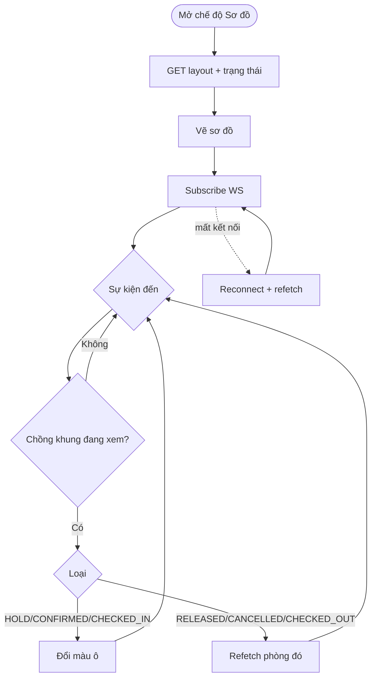

# [FD-ROM-03] Xem sơ đồ phòng real-time (View Live Room Map) ⭐

## 0. Thông tin tài liệu

| Mục | Nội dung |
|---|---|
| Mã chức năng | FD-ROM-03 |
| Tên | Xem sơ đồ phòng real-time (View Live Room Map) |
| Module | ROM |
| Version | v0.1 |
| Trạng thái | Draft |
| Người viết | A |
| Người duyệt | A (kỹ thuật) · PO (nghiệp vụ) |
| Owner | BE: A · FE: C |
| Task | KTV-41, KTV-42, KTV-47 |

| Version | Ngày | Người | Nội dung |
|---|---|---|---|
| v0.1 | 2026-10-21 | A | Tạo mới |

## 1. Tổng quan

- **Mục đích:** Hiển thị mặt bằng chi nhánh với trạng thái từng phòng **cập nhật tức thì** khi có người giữ / đặt / hủy / check-in / check-out. Là "wow factor" của sản phẩm.
- **Phạm vi:** API trạng thái phòng theo khung giờ, kênh WebSocket, component `RoomMap` (khách hàng + nhân viên). **Ngoài phạm vi:** chỉnh sơ đồ (BRN-03).
- **Actor:** Guest, Customer, Staff.
- **Ưu tiên:** Should.
- **Tham chiếu:** C06 · BR-11, BR-12 · 01-business §7 · SCR-C07 (chế độ Sơ đồ), SCR-S01 · FD-ROM-02, FD-BKG-01→03, FD-BKG-05, FD-BKG-07, FD-OPS-03, FD-OPS-06, FD-BRN-03.

## 2. Mô tả nghiệp vụ

### 2.1 Tiền điều kiện
- Chi nhánh có phòng; nếu chưa có tọa độ (`pos_x` null) → hiển thị dạng lưới (phương án dự phòng).

### 2.2 Hậu điều kiện
- Không đổi dữ liệu.

### 2.3 Luồng chính
1. Khách chọn chế độ **"Sơ đồ"** ở SCR-C07 (đã có tham số chi nhánh + khung giờ).
2. FE gọi API lấy layout + trạng thái phòng **trong khung giờ đang xem**.
3. FE vẽ sơ đồ: mỗi phòng 1 ô theo `pos_x, pos_y, width, height`, màu theo trạng thái.
4. FE kết nối WebSocket, subscribe `/topic/branches/{branchId}/rooms`.
5. Khi có sự kiện: nếu khoảng `[from, to]` của sự kiện **chồng** khung giờ đang xem → cập nhật màu ô (có hiệu ứng nhấp nháy 1 giây).
6. Khách bấm ô 🟢 → BKG-01. Ô 🟡/🔴/⚫ → tooltip, không cho chọn.
7. Rời trang → unsubscribe, đóng kết nối.

### 2.4 Luồng thay thế / ngoại lệ

| Mã | Tại bước | Điều kiện | Xử lý |
|---|---|---|---|
| A1 | 3 | Chưa có layout | Hiển thị dạng lưới, vẫn real-time |
| A2 | 4 | Mất kết nối | Banner "Đang kết nối lại…"; auto reconnect (backoff 1s→2s→5s→10s); kết nối lại xong **refetch** bước 2 |
| A3 | 5 | Sự kiện `RELEASED` nhưng phòng còn booking khác chồng khung | Không tự đổi 🟢 – **refetch trạng thái phòng đó** (`GET .../rooms?roomId=`) |
| A4 | – | Staff (SCR-S01) | Khung giờ = "hiện tại"; thêm trạng thái 🔵 *đang dọn* (15' sau check-out) |

### 2.5 Activity diagram



### 2.6 Bảng trạng thái hiển thị

| Trạng thái API | Từ booking | Màu | Cho chọn |
|---|---|---|---|
| `AVAILABLE` | Không có booking chặn | 🟢 | ✓ |
| `HELD` | `HOLD`, `PENDING_PAYMENT` | 🟡 + "còn mm:ss" | ✗ |
| `BOOKED` | `CONFIRMED` | 🔴 | ✗ |
| `IN_USE` | `CHECKED_IN` | 🔴 + icon micro | ✗ |
| `CLEANING` | trong 15' sau check-out (chỉ staff) | 🔵 | ✗ |
| `MAINTENANCE` | `rooms.status` | ⚫ | ✗ |

## 3. Giao diện

- **Màn hình:** SCR-C07 (chế độ Sơ đồ), SCR-S01 – **Wireframe: TODO**

### 3.1 Danh sách item

| No | Item | Loại | Ghi chú |
|---|---|---|---|
| 1 | Khung sơ đồ | SVG `viewBox = 0 0 map_width map_height` | Responsive; mobile cho pinch-zoom / cuộn ngang |
| 2 | Ô phòng | `<g>` rect + text | Mã phòng, loại, sức chứa; màu theo §2.6 |
| 3 | Chú giải | Legend | 🟢🟡🔴⚫ |
| 4 | Chỉ báo kết nối | Badge | "● Trực tiếp" xanh / "Đang kết nối lại" cam |
| 5 | Tooltip | Popover | Giá dự tính (🟢), "Đang được giữ – còn 07:12" (🟡) |

## 4. Thiết kế xử lý

### 4.1 API

**Snapshot**

| Mục | Giá trị |
|---|---|
| Endpoint | `GET /api/v1/branches/{id}/rooms?start=...&end=...` (bỏ trống = hiện tại) |
| Quyền | Public |

```json
{ "success": true, "data": {
  "branch": { "id": 1, "mapWidth": 1000, "mapHeight": 600 },
  "rooms": [ { "id": 12, "code": "V02", "type": "VIP", "capacity": 10,
               "posX": 120, "posY": 40, "width": 160, "height": 100,
               "status": "HELD", "holdExpiresAt": "..." } ],
  "serverTime": "..." } }
```

**WebSocket**

| Thành phần | Giá trị |
|---|---|
| Endpoint | `/ws` (STOMP over SockJS) – không cần auth để subscribe |
| Topic | `/topic/branches/{branchId}/rooms` |
| Payload | `{ "roomId": 12, "event": "HOLD", "status": "HELD", "from": "...", "to": "...", "holdExpiresAt": "...", "at": "..." }` |
| `event` | `HOLD`, `RELEASED`, `PENDING_PAYMENT`, `CONFIRMED`, `CANCELLED`, `CHECKED_IN`, `CHECKED_OUT`, `EXTENDED`, `MAINTENANCE_CHANGED` |

### 4.2 Các bước xử lý
- BE: `RoomStatusPublisher` lắng nghe `RoomStatusEvent` bằng `@TransactionalEventListener(AFTER_COMMIT)` → `SimpMessagingTemplate.convertAndSend(topic, payload)`.
- BE: Simple broker trong bộ nhớ (1 instance). Nhiều instance → cần relay (ngoài phạm vi).
- FE: hook `useRoomStatus(branchId, window)` – `@stomp/stompjs` `reconnectDelay`, `onConnect` → refetch (TanStack Query `invalidateQueries`).

### 4.3 Sequence diagram

```mermaid
sequenceDiagram
  actor A as Khách A
  actor B as Khách B
  participant FEA as FE (A)
  participant FEB as FE (B)
  participant BE as Spring Boot
  participant BR as STOMP Broker

  FEB->>BE: GET /branches/1/rooms?start&end
  BE-->>FEB: snapshot (V02 AVAILABLE)
  FEB->>BR: SUBSCRIBE /topic/branches/1/rooms
  A->>FEA: Chọn V02
  FEA->>BE: POST /bookings/hold
  BE->>BE: INSERT + COMMIT
  BE->>BR: publish {roomId:12, event:HOLD}
  BR-->>FEB: MESSAGE
  FEB->>B: V02 → 🟡 (nhấp nháy)
  Note over FEB: B bấm V02 → bị chặn ở FE; nếu cố gọi API → 409
```

### 4.4 Dữ liệu tác động

| Bảng | C | R | U | D |
|---|---|---|---|---|
| branches, rooms, room_types, bookings | | ✓ | | |

## 5. Bảo mật & phân quyền
- Topic public: payload **không** chứa thông tin khách / mã đơn / giá.
- Chặn client gửi lên `/topic/**` (chỉ server publish).

## 6. Yêu cầu phi chức năng
- Độ trễ hiển thị sự kiện ≤ 2 giây.
- Snapshot < 300ms.
- Hoạt động trên mobile ≥ 375px (NFR-04).

## 7. Tiêu chí nghiệm thu

| Mã | Given | When | Then |
|---|---|---|---|
| AC-ROM-03-01 | A và B cùng xem chi nhánh 1, khung 19:00–21:00 | A giữ V02 | B thấy V02 🟡 ≤ 2s |
| AC-ROM-03-02 | B xem khung 10:00–12:00 | A giữ V02 19:00–21:00 | Sơ đồ B không đổi |
| AC-ROM-03-03 | V02 🟡 | Job hết hạn chạy | B thấy V02 🟢 |
| AC-ROM-03-04 | Tắt mạng B 10s rồi bật | Trong lúc tắt có sự kiện | Sau khi kết nối lại, sơ đồ B đúng với DB |
| AC-ROM-03-05 | Chi nhánh chưa có layout | Mở chế độ Sơ đồ | Hiện dạng lưới, vẫn real-time |
| AC-ROM-03-06 | – | Client cố SEND tới `/topic/...` | Bị từ chối |

## 8. Vấn đề mở / Giả định

| # | Nội dung | Loại | Người xử lý | Trạng thái |
|---|---|---|---|---|
| 1 | Đổi tên topic thống nhất `/topic/branches/{id}/rooms` (02-architecture đã dùng tên này) | Xác nhận | A | Closed |
| 2 | Trạng thái `CLEANING` chỉ suy ra từ `checked_out_at + 15'` – không lưu DB | Giả định | A | Open |

## 9. Phê duyệt

| Vai trò | Người | Ngày | Kết quả |
|---|---|---|---|
| Tech Lead | A | | |
| PO / Trưởng nhóm | | | |
